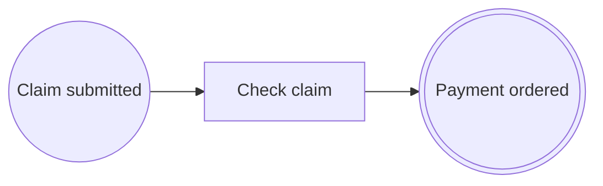

# Lesson 1. Your first process and its diagram

> 🇪🇸 [Versión en español](../../es/curso/01-primer-proceso.md)

**Goal:** create the `expenses` application, declare a three-step process with annotations and see its BPMN 2.0
diagram generated from the code.

## What you will learn

- Which dependencies a Spring Boot application needs to use `bpmncode`.
- How a process is declared: a class with `@Process` and an annotated method for each step.
- How steps are connected with `@SequenceFlow` and why the order of the methods does not matter.
- What the library does at startup and how to export the diagram with `BpmnDiagramService`.

## Starting point

Nothing: you start with an empty directory. If you prefer, generate a Maven project with
[start.spring.io](https://start.spring.io) (Java 21, Spring Boot 4.1, *Spring Web* dependency) and replace its
`pom.xml` with the one from step 1.

## Steps

### 1. Create the project

`bpmncode` is just another dependency. It brings no process engine and no mandatory database: without a database, it
stores instances in memory. Also add its **annotation processor**, which checks your processes while you compile
(you will see it in depth in [lesson 4](04-validation.md)). Since JDK 23, `javac` no longer runs the processors it
finds on the classpath, so you have to name it.

`pom.xml`:

```xml
<?xml version="1.0" encoding="UTF-8"?>
<project xmlns="http://maven.apache.org/POM/4.0.0" xmlns:xsi="http://www.w3.org/2001/XMLSchema-instance"
	xsi:schemaLocation="http://maven.apache.org/POM/4.0.0 https://maven.apache.org/xsd/maven-4.0.0.xsd">
	<modelVersion>4.0.0</modelVersion>

	<parent>
		<groupId>org.springframework.boot</groupId>
		<artifactId>spring-boot-starter-parent</artifactId>
		<version>4.1.1</version>
		<relativePath/>
	</parent>

	<groupId>com.example</groupId>
	<artifactId>expenses</artifactId>
	<version>0.0.1-SNAPSHOT</version>

	<properties>
		<java.version>21</java.version>
		<bpmncode.version>0.1.0</bpmncode.version>
	</properties>

	<dependencies>
		<dependency>
			<groupId>org.springframework.boot</groupId>
			<artifactId>spring-boot-starter-webmvc</artifactId>
		</dependency>
		<dependency>
			<groupId>io.github.eldiegos</groupId>
			<artifactId>bpmncode</artifactId>
			<version>${bpmncode.version}</version>
		</dependency>
		<dependency>
			<groupId>org.springframework.boot</groupId>
			<artifactId>spring-boot-starter-test</artifactId>
			<scope>test</scope>
		</dependency>
	</dependencies>

	<build>
		<plugins>
			<plugin>
				<groupId>org.apache.maven.plugins</groupId>
				<artifactId>maven-compiler-plugin</artifactId>
				<configuration>
					<annotationProcessors>
						<annotationProcessor>io.github.eldiegos.bpmncode.processor.ProcessAnnotationProcessor</annotationProcessor>
					</annotationProcessors>
				</configuration>
			</plugin>
			<plugin>
				<groupId>org.springframework.boot</groupId>
				<artifactId>spring-boot-maven-plugin</artifactId>
			</plugin>
		</plugins>
	</build>
</project>
```

If your project already uses other processors (Lombok, MapStruct…), list them all in `annotationProcessors`: once you
name one, `javac` stops looking for the others.

### 2. The application class

The library looks for processes in the package of the `@SpringBootApplication` class and its subpackages, just as
Spring looks for your components. There is nothing to enable.

`src/main/java/com/example/expenses/ExpensesApplication.java`:

```java
package com.example.expenses;

import org.springframework.boot.SpringApplication;
import org.springframework.boot.autoconfigure.SpringBootApplication;

@SpringBootApplication
public class ExpensesApplication {

	public static void main(String[] args) {
		SpringApplication.run(ExpensesApplication.class, args);
	}
}
```

### 3. The business data

The claim is a plain record. The process does not store it: your data stays yours.

`src/main/java/com/example/expenses/claim/ExpenseClaim.java`:

```java
package com.example.expenses.claim;

import java.math.BigDecimal;
import java.util.UUID;

public record ExpenseClaim(UUID id, String employee, BigDecimal amount, boolean receiptsAttached) {
}
```

### 4. The process

A process is a class with `@Process`. Each **flow node** (an event, a task, a decision) is an annotated method. This
first version has three:

- `@StartEvent`: where the process starts. This one is started by a call from your code.
- `@ServiceTask`: work done by the system, here checking the claim.
- `@EndEvent`: where it ends.

Each node (except end nodes) declares its outgoing flow with `outgoing = @SequenceFlow(targetRef = "…")`, the id of
the node it leads to. That is why **the order of the methods in the class does not matter**: the graph comes from the
`targetRef`s, not from the position.

`src/main/java/com/example/expenses/claim/ExpenseClaimProcess.java`:

```java
package com.example.expenses.claim;

import org.springframework.stereotype.Service;

import io.github.eldiegos.bpmncode.annotation.EndEvent;
import io.github.eldiegos.bpmncode.annotation.Process;
import io.github.eldiegos.bpmncode.annotation.SequenceFlow;
import io.github.eldiegos.bpmncode.annotation.ServiceTask;
import io.github.eldiegos.bpmncode.annotation.StartEvent;

@Service
@Process(id = "EXP-CLAIM", name = "Expense claim", version = 1,
		documentation = "An employee claims an expense; large amounts need the approval of a manager before payment.")
public class ExpenseClaimProcess {

	@StartEvent(id = "EXP-SUBMITTED", name = "Claim submitted", outgoing = @SequenceFlow(targetRef = "EXP-CHECK"))
	public void submit(ExpenseClaim claim) {
		check(claim);
		paymentOrdered(claim);
	}

	@ServiceTask(id = "EXP-CHECK", name = "Check claim", outgoing = @SequenceFlow(targetRef = "EXP-PAYMENT-ORDERED"))
	void check(ExpenseClaim claim) {
		// The real check comes in lesson 2.
	}

	@EndEvent(id = "EXP-PAYMENT-ORDERED", name = "Payment ordered")
	void paymentOrdered(ExpenseClaim claim) {
	}
}
```

Notice three things:

- **The ids** (`EXP-CLAIM`, `EXP-SUBMITTED`…) are stable and unique across the whole application. They end up as XML
  ids in the BPMN, so they start with a letter or `_` and contain no spaces. The `EXP-` prefix avoids clashes with
  other processes.
- **`name`** is mandatory: it is the canonical text shown in the diagram. English is recommended, and it is translated
  separately (lesson 10).
- **The annotations execute nothing.** They describe the process. Your code is what calls `check` and
  `paymentOrdered`, as always. In lesson 5 you will make each step leave a record.

### 5. Start the application

```bash
./mvnw spring-boot:run
```

At startup, `bpmncode` finds the annotated classes, builds the model and validates it. If something does not fit, the
application does not start (lesson 4). If all goes well, you will see these lines in the log:

```
i.g.e.b.model.ProcessDefinitionRegistry  : Process definition EXP-CLAIM v1 'Expense claim': 3 flow nodes, 2 sequence flows
.g.e.b.r.ProcessRuntimeAutoConfiguration : Process instances are stored with InMemoryProcessInstanceStore
```

The first one says it has found your process; the second one, that instances will go to memory because there is no
database.

### 6. Expose the diagram

The diagram is not drawn by hand: it is derived from the model. `BpmnDiagramService` is a bean the library registers
on its own. `diagram(id)` looks up a diagram by its id (a process's diagram has the process id) and `xml(…)` generates
the BPMN 2.0 document. `LabelResolver.CANONICAL` leaves the texts exactly as you wrote them.

`src/main/java/com/example/expenses/DiagramController.java`:

```java
package com.example.expenses;

import org.springframework.http.HttpStatus;
import org.springframework.http.MediaType;
import org.springframework.web.bind.annotation.GetMapping;
import org.springframework.web.bind.annotation.PathVariable;
import org.springframework.web.bind.annotation.RestController;
import org.springframework.web.server.ResponseStatusException;

import io.github.eldiegos.bpmncode.bpmn.BpmnDiagramService;
import io.github.eldiegos.bpmncode.i18n.LabelResolver;

@RestController
class DiagramController {

	private final BpmnDiagramService diagrams;

	DiagramController(BpmnDiagramService diagrams) {
		this.diagrams = diagrams;
	}

	@GetMapping(value = "/bpmn/{id}", produces = MediaType.APPLICATION_XML_VALUE)
	String bpmn(@PathVariable String id) {
		var diagram = diagrams.diagram(id).orElseThrow(() -> new ResponseStatusException(HttpStatus.NOT_FOUND));
		return diagrams.xml(diagram, "en", LabelResolver.CANONICAL);
	}
}
```

The second argument of `xml` is the language: the library caches one document per diagram and language.

## Check that it works

Restart the application and request the diagram:

```bash
curl -s localhost:8080/bpmn/EXP-CLAIM > expense-claim.bpmn
```

The file starts like this (abridged):

```xml
<bpmn:definitions … exporter="bpmncode" id="Definitions_EXP-CLAIM" targetNamespace="https://pac.dev/process/EXP-CLAIM">
  <bpmn:process id="EXP-CLAIM" isExecutable="false" name="Expense claim" pac:version="1">
    <bpmn:startEvent id="EXP-SUBMITTED" name="Claim submitted">
      <bpmn:extensionElements>
        <pac:implementation class="com.example.expenses.claim.ExpenseClaimProcess" method="submit(ExpenseClaim)"/>
      </bpmn:extensionElements>
      <bpmn:outgoing>Flow_EXP-SUBMITTED_EXP-CHECK</bpmn:outgoing>
    </bpmn:startEvent>
    <bpmn:serviceTask id="EXP-CHECK" name="Check claim">…</bpmn:serviceTask>
    <bpmn:endEvent id="EXP-PAYMENT-ORDERED" name="Payment ordered">…</bpmn:endEvent>
    <bpmn:sequenceFlow id="Flow_EXP-SUBMITTED_EXP-CHECK" sourceRef="EXP-SUBMITTED" targetRef="EXP-CHECK"/>
    <bpmn:sequenceFlow id="Flow_EXP-CHECK_EXP-PAYMENT-ORDERED" sourceRef="EXP-CHECK" targetRef="EXP-PAYMENT-ORDERED"/>
  </bpmn:process>
  <bpmndi:BPMNDiagram id="Diagram_EXP-CLAIM">…</bpmndi:BPMNDiagram>
</bpmn:definitions>
```

Open [demo.bpmn.io](https://demo.bpmn.io) and drag the file onto it: you will see three nodes from left to right.



Notice two things about the XML:

- The flows have an id even though you did not write one: by default it is `Flow_<source>_<target>`.
- `pac:implementation` says which class and which method implement each node. BPMN has nowhere to store that, so it
  goes in a `pac:` extension. It is the basis of traceability (lesson 10).

## Common mistakes

- **`curl` returns 404.** The id is not a diagram's id. Try exactly `EXP-CLAIM` (uppercase included).
- **The `Process definition EXP-CLAIM v1…` line does not appear.** The process class is not under the package of
  `ExpensesApplication` (`com.example.expenses`). Move it to a subpackage.
- **An id with spaces, e.g. `"EXP CHECK"`.** It does not compile; the processor flags it on the annotation:

  ```
  identifier 'EXP CHECK' is invalid: it must start with a letter or '_' and contain only letters, digits, '-', '_' or '.'
  ```

- **`name = ""`.** It does not compile either: `the readable name is missing`.

## Exercise

Add a `documentation` to the `EXP-CHECK` task ("Verifies the claim before anything is paid.") and check where it
appears in the XML.

<details><summary>Solution</summary>

`documentation` is an optional attribute of every node annotation:

```java
@ServiceTask(id = "EXP-CHECK", name = "Check claim",
		documentation = "Verifies the claim before anything is paid.",
		outgoing = @SequenceFlow(targetRef = "EXP-PAYMENT-ORDERED"))
void check(ExpenseClaim claim) {
}
```

In the XML it appears as `<bpmn:documentation>Verifies the claim before anything is paid.</bpmn:documentation>` inside
`<bpmn:serviceTask id="EXP-CHECK" …>`. It only carries business text: technical data goes in `pac:` extensions.

</details>

## Learn more

- [Getting started](../getting-started.md): the same setup, summarized.
- [Annotations: identifiers and names](../annotations.md#identifiers-and-names) and
  [`@Process`](../annotations.md#process).
- [Configuration: where processes are looked up](../configuration.md#where-processes-are-looked-up).
- [BPMN 2.0 export](../bpmn-traceability-i18n.md#bpmn-20-export).

---

[Index](README.md) | [Next: Tasks, flows and business rules →](02-tasks-and-rules.md)
