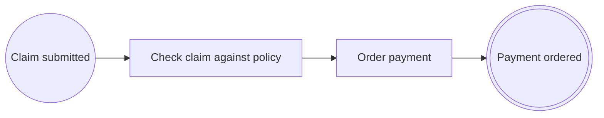

# Lesson 2. Tasks, flows and business rules

> 🇪🇸 [Versión en español](../../es/curso/02-tareas-y-reglas.md)

**Goal:** turn the check into a business rule task tied to its code, add the payment order and tidy up the process
ids.

## What you will learn

- The three task types (`@ServiceTask`, `@UserTask`, `@BusinessRuleTask`) and when to use each one.
- Which attributes a `@SequenceFlow` has and which rules the outgoing flow of a task follows.
- How to mark the code of a business rule with `@BusinessRule` and reference it from a node.
- Why it pays to declare ids as constants.

## Starting point

The project from [lesson 1](01-first-process.md): `ExpensesApplication`, `ExpenseClaim`, `DiagramController` and
`ExpenseClaimProcess` with three nodes (`EXP-SUBMITTED` → `EXP-CHECK` → `EXP-PAYMENT-ORDERED`).

## Steps

### 1. The three task types

The three task annotations have the same attributes and behave the same at run time. The difference is what they tell
in the diagram, which is what the business will read:

| Annotation | Use it when… | In the course |
|---|---|---|
| `@ServiceTask` | the system does the work on its own | `EXP-PAY`: order the payment |
| `@UserTask` | a person has to do something (approve, review…) | `EXP-APPROVE`, in lesson 3 |
| `@BusinessRuleTask` | the step applies business rules | `EXP-CHECK`: apply the expense policy |

All of them require **exactly one** outgoing flow, without a condition. To choose between several paths you need a
gateway (lesson 3).

There is a fourth task, `@SendTask`, which also publishes a message for another process; it only makes sense when
there are messages between processes, so you will see it in lesson 7.

### 2. Declare the ids as constants

You are going to repeat them: in the annotations (`id`, `targetRef`) and, from lesson 5 on, in the calls to the
journal. A `static final String` constant is a constant expression, so it is valid inside an annotation, and a typo
stops compiling instead of failing at run time.

```java
public static final String PROCESS_ID = "EXP-CLAIM";
public static final String SUBMITTED = "EXP-SUBMITTED";
public static final String CHECK = "EXP-CHECK";
public static final String PAY = "EXP-PAY";
public static final String PAYMENT_ORDERED = "EXP-PAYMENT-ORDERED";
```

They are `public` because other classes in the course (version 2 of the process, the tests) will use them.

### 3. Mark the rule's code

A **business rule** is a decision the business wants to be able to point to and audit: "a claim needs receipts and a
positive amount". `@BusinessRule` executes nothing: it identifies the code that implements the rule, with a stable id
(`R-EXP-001`) and a readable name. That way the diagram, the traceability and the history can say which rule was
applied and where its code is.

`src/main/java/com/example/expenses/claim/ExpensePolicyRule.java`:

```java
package com.example.expenses.claim;

import java.math.BigDecimal;

import io.github.eldiegos.bpmncode.annotation.BusinessRule;

public final class ExpensePolicyRule {

	public static final String ID = "R-EXP-001";

	private ExpensePolicyRule() {
	}

	@BusinessRule(id = ID, name = "Claim with receipts and a positive amount",
			documentation = "A claim needs its receipts and an amount greater than zero.")
	public static boolean complies(ExpenseClaim claim) {
		return claim.receiptsAttached() && claim.amount().compareTo(BigDecimal.ZERO) > 0;
	}
}
```

`@BusinessRule` can go on a method or on a class. Its `version` is 1 by default; in
[lesson 9](09-versions.md) you will create version 2 of another rule.

### 4. Rewrite the process

Changes from lesson 1:

- `EXP-CHECK` becomes a `@BusinessRuleTask` and references the rule with `businessRuleRefs`. A rule task without
  rules does not compile.
- New task `EXP-PAY` ("Order payment") between the check and the end.
- The ids come from the constants.

`src/main/java/com/example/expenses/claim/ExpenseClaimProcess.java`:

```java
package com.example.expenses.claim;

import org.springframework.stereotype.Service;

import io.github.eldiegos.bpmncode.annotation.BusinessRuleTask;
import io.github.eldiegos.bpmncode.annotation.EndEvent;
import io.github.eldiegos.bpmncode.annotation.Process;
import io.github.eldiegos.bpmncode.annotation.SequenceFlow;
import io.github.eldiegos.bpmncode.annotation.ServiceTask;
import io.github.eldiegos.bpmncode.annotation.StartEvent;

@Service
@Process(id = ExpenseClaimProcess.PROCESS_ID, name = "Expense claim", version = 1,
		documentation = "An employee claims an expense; large amounts need the approval of a manager before payment.")
public class ExpenseClaimProcess {

	public static final String PROCESS_ID = "EXP-CLAIM";
	public static final String SUBMITTED = "EXP-SUBMITTED";
	public static final String CHECK = "EXP-CHECK";
	public static final String PAY = "EXP-PAY";
	public static final String PAYMENT_ORDERED = "EXP-PAYMENT-ORDERED";

	@StartEvent(id = SUBMITTED, name = "Claim submitted", outgoing = @SequenceFlow(targetRef = CHECK))
	public void submit(ExpenseClaim claim) {
		check(claim);
		pay(claim);
	}

	@BusinessRuleTask(id = CHECK, name = "Check claim against policy", businessRuleRefs = ExpensePolicyRule.ID,
			outgoing = @SequenceFlow(targetRef = PAY))
	boolean check(ExpenseClaim claim) {
		return ExpensePolicyRule.complies(claim);
	}

	@ServiceTask(id = PAY, name = "Order payment", outgoing = @SequenceFlow(targetRef = PAYMENT_ORDERED))
	void pay(ExpenseClaim claim) {
		paymentOrdered(claim);
	}

	@EndEvent(id = PAYMENT_ORDERED, name = "Payment ordered")
	void paymentOrdered(ExpenseClaim claim) {
	}
}
```

For now the result of `check` decides nothing: every claim gets paid. You will fix that in lesson 3.

### 5. The attributes of `@SequenceFlow`

So far you have only used `targetRef`. These are all of them:

| Attribute | What for |
|---|---|
| `targetRef` | id of the target node (mandatory) |
| `id` | id of the flow; by default `Flow_<source>_<target>`, e.g. `Flow_EXP-CHECK_EXP-PAY` |
| `name` | label of the flow in the diagram |
| `when` | gateways only: the `enum` constant that selects this branch |
| `conditionExpression` | gateways only: the condition as readable text |

`when` and `conditionExpression` on a task do not compile: a task does not decide, it just continues.

## Check that it works

Start the application (`./mvnw spring-boot:run`). The log now counts four nodes and three flows:

```
Process definition EXP-CLAIM v1 'Expense claim': 4 flow nodes, 3 sequence flows
```

Request the diagram (`curl -s localhost:8080/bpmn/EXP-CLAIM`). The check is now a `businessRuleTask` and carries the
rule as an extension, with its name and its version:

```xml
<bpmn:businessRuleTask id="EXP-CHECK" name="Check claim against policy">
  <bpmn:extensionElements>
    <pac:implementation class="com.example.expenses.claim.ExpenseClaimProcess" method="check(ExpenseClaim)"/>
    <pac:businessRuleRef id="R-EXP-001" name="Claim with receipts and a positive amount" version="1"/>
  </bpmn:extensionElements>
  …
</bpmn:businessRuleTask>
```



## Common mistakes

`javac` detects all of these thanks to the processor, on the annotation's line:

- **Two outgoing flows on a task** (`outgoing = { @SequenceFlow(…), @SequenceFlow(…) }`):

  ```
  declares exactly one outgoing sequence flow; use an exclusive gateway to branch
  ```

- **`@BusinessRuleTask` without rules** (`businessRuleRefs = {}`):

  ```
  a business rule task must reference at least one business rule
  ```

- **`when` or `conditionExpression` on a task's flow**:

  ```
  'when' and 'conditionExpression' are only allowed on the outgoing sequence flows of an exclusive gateway
  ```

- **A rule that does not exist** (`businessRuleRefs = "R-EXP-01"`). This is no longer local to the annotation, so it
  compiles; it fails at startup with `UNKNOWN_BUSINESS_RULE_REF` (lesson 4).

## Exercise

A large process does not have to fit in one class. Move the `EXP-PAY` task to a class of its own, `ClaimPayment`,
without changing the model.

<details><summary>Solution</summary>

`@ProcessPart(processRef = …)` says which process a class contributes nodes to. The `targetRef`s can point to nodes in
another class of the same process.

```java
package com.example.expenses.claim;

import org.springframework.stereotype.Component;

import io.github.eldiegos.bpmncode.annotation.ProcessPart;
import io.github.eldiegos.bpmncode.annotation.SequenceFlow;
import io.github.eldiegos.bpmncode.annotation.ServiceTask;

@Component
@ProcessPart(processRef = ExpenseClaimProcess.PROCESS_ID)
class ClaimPayment {

	@ServiceTask(id = ExpenseClaimProcess.PAY, name = "Order payment",
			outgoing = @SequenceFlow(targetRef = ExpenseClaimProcess.PAYMENT_ORDERED))
	void pay(ExpenseClaim claim) {
	}
}
```

In `ExpenseClaimProcess` delete the `pay` method, inject `ClaimPayment` through the constructor and call
`payment.pay(claim)` followed by `paymentOrdered(claim)` from `submit`. The log still says
`4 flow nodes, 3 sequence flows`.

`version` can be omitted in `@ProcessPart` only while the process has a single version. The rest of the course keeps
everything in `ExpenseClaimProcess`: undo the change before moving on to lesson 3.

</details>

## Learn more

- [Tasks: `@ServiceTask`, `@UserTask`, `@BusinessRuleTask`](../annotations.md#tasks-servicetask-usertask-businessruletask)
- [`@SequenceFlow`](../annotations.md#sequenceflow) and [`@ProcessPart`](../annotations.md#processpart)
- [`@BusinessRule`](../annotations.md#businessrule)

---

[← Previous: Your first process](01-first-process.md) | [Index](README.md) | [Next: Decisions with gateways →](03-decisions-with-gateways.md)
