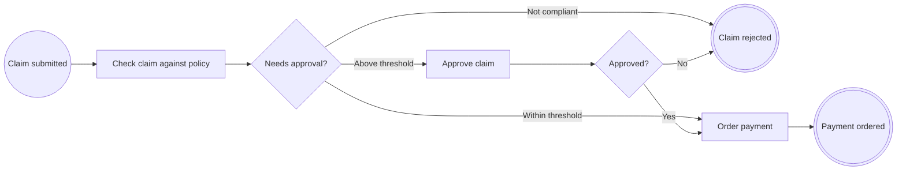

# Lesson 3. Decisions with gateways

> 🇪🇸 [Versión en español](../../es/curso/03-decisiones-con-gateways.md)

**Goal:** make the process decide: reject what does not comply with the policy, pay small amounts directly and ask a
manager to approve large ones.

## What you will learn

- How a decision is modelled with `@ExclusiveGateway` and why its method returns an `enum`.
- How to tie each branch to a constant with `when` and describe it with `name` and `conditionExpression`.
- How to add a human task (`@UserTask`) and a second end event.
- That several flows can arrive at the same node.

## Starting point

The code from [lesson 2](02-tasks-and-rules.md): `ExpenseClaimProcess` with `EXP-SUBMITTED` → `EXP-CHECK`
(rule `R-EXP-001`) → `EXP-PAY` → `EXP-PAYMENT-ORDERED`, and the `ExpensePolicyRule` class.

## Steps

### 1. Why an `enum`

An **exclusive gateway** is a point where the process continues along **only one** of several branches. In
`bpmncode` it is a method that returns an `enum`, and each constant is a branch: the `when` attribute of each
`@SequenceFlow` names the constant that selects it.

That way the branch is tied to the code and not to a piece of text: the compiler forces you to handle every constant in
a `switch`, and the processor checks that the constants and the `when`s match **exactly**, not one more and not one
less.

You are going to need two decisions:

```java
public enum Route { NON_COMPLIANT, NEEDS_APPROVAL, AUTO_APPROVED }

public enum Decision { APPROVED, REJECTED }
```

### 2. The threshold rule

The "needs approval?" decision depends on a new business rule, `R-EXP-002`: more than 1,000 EUR needs the approval of
a manager.

`src/main/java/com/example/expenses/claim/ApprovalThresholdRule.java`:

```java
package com.example.expenses.claim;

import java.math.BigDecimal;

import io.github.eldiegos.bpmncode.annotation.BusinessRule;

public final class ApprovalThresholdRule {

	public static final String ID = "R-EXP-002";

	private static final BigDecimal THRESHOLD = new BigDecimal("1000");

	private ApprovalThresholdRule() {
	}

	@BusinessRule(id = ID, name = "Manager approval above 1,000 EUR")
	public static boolean needsApproval(BigDecimal amount) {
		return amount.compareTo(THRESHOLD) > 0;
	}
}
```

Gateways also accept `businessRuleRefs`: the diagram will show which rule decides the branch.

### 3. The process with its decisions

New nodes:

| Id | Annotation | Name |
|---|---|---|
| `EXP-ROUTE` | `@ExclusiveGateway` | Needs approval? |
| `EXP-APPROVE` | `@UserTask` | Approve claim |
| `EXP-DECISION` | `@ExclusiveGateway` | Approved? |
| `EXP-REJECTED` | `@EndEvent` | Claim rejected |

`EXP-CHECK` no longer goes to `EXP-PAY`, but to `EXP-ROUTE`. Two flows arrive at `EXP-PAY` (from `EXP-ROUTE` and from
`EXP-DECISION`) and two at `EXP-REJECTED`: a node can have as many incoming flows as needed.

`src/main/java/com/example/expenses/claim/ExpenseClaimProcess.java`:

```java
package com.example.expenses.claim;

import org.springframework.stereotype.Service;

import io.github.eldiegos.bpmncode.annotation.BusinessRuleTask;
import io.github.eldiegos.bpmncode.annotation.EndEvent;
import io.github.eldiegos.bpmncode.annotation.ExclusiveGateway;
import io.github.eldiegos.bpmncode.annotation.Process;
import io.github.eldiegos.bpmncode.annotation.SequenceFlow;
import io.github.eldiegos.bpmncode.annotation.ServiceTask;
import io.github.eldiegos.bpmncode.annotation.StartEvent;
import io.github.eldiegos.bpmncode.annotation.UserTask;

@Service
@Process(id = ExpenseClaimProcess.PROCESS_ID, name = "Expense claim", version = 1,
		documentation = "An employee claims an expense; large amounts need the approval of a manager before payment.")
public class ExpenseClaimProcess {

	public static final String PROCESS_ID = "EXP-CLAIM";
	public static final String SUBMITTED = "EXP-SUBMITTED";
	public static final String CHECK = "EXP-CHECK";
	public static final String ROUTE = "EXP-ROUTE";
	public static final String APPROVE = "EXP-APPROVE";
	public static final String DECISION = "EXP-DECISION";
	public static final String PAY = "EXP-PAY";
	public static final String PAYMENT_ORDERED = "EXP-PAYMENT-ORDERED";
	public static final String REJECTED = "EXP-REJECTED";

	public enum Route { NON_COMPLIANT, NEEDS_APPROVAL, AUTO_APPROVED }

	public enum Decision { APPROVED, REJECTED }

	@StartEvent(id = SUBMITTED, name = "Claim submitted", outgoing = @SequenceFlow(targetRef = CHECK))
	public void submit(ExpenseClaim claim) {
		var compliant = check(claim);
		switch (route(claim, compliant)) {
			case NON_COMPLIANT -> reject(claim);
			case AUTO_APPROVED -> pay(claim);
			case NEEDS_APPROVAL -> {
				// A manager decides later: approve(...)
			}
		}
	}

	@BusinessRuleTask(id = CHECK, name = "Check claim against policy", businessRuleRefs = ExpensePolicyRule.ID,
			outgoing = @SequenceFlow(targetRef = ROUTE))
	boolean check(ExpenseClaim claim) {
		return ExpensePolicyRule.complies(claim);
	}

	@ExclusiveGateway(id = ROUTE, name = "Needs approval?", businessRuleRefs = ApprovalThresholdRule.ID,
			outgoing = {
					@SequenceFlow(when = "NON_COMPLIANT", targetRef = REJECTED, name = "Not compliant"),
					@SequenceFlow(when = "NEEDS_APPROVAL", targetRef = APPROVE, name = "Above threshold",
							conditionExpression = "Amount > 1,000 EUR"),
					@SequenceFlow(when = "AUTO_APPROVED", targetRef = PAY, name = "Within threshold") })
	Route route(ExpenseClaim claim, boolean compliant) {
		if (!compliant) {
			return Route.NON_COMPLIANT;
		}
		return ApprovalThresholdRule.needsApproval(claim.amount()) ? Route.NEEDS_APPROVAL : Route.AUTO_APPROVED;
	}

	@UserTask(id = APPROVE, name = "Approve claim", outgoing = @SequenceFlow(targetRef = DECISION))
	public void approve(ExpenseClaim claim, Decision decision) {
		switch (decide(decision)) {
			case APPROVED -> pay(claim);
			case REJECTED -> reject(claim);
		}
	}

	@ExclusiveGateway(id = DECISION, name = "Approved?",
			outgoing = {
					@SequenceFlow(when = "APPROVED", targetRef = PAY, name = "Yes"),
					@SequenceFlow(when = "REJECTED", targetRef = REJECTED, name = "No") })
	Decision decide(Decision decision) {
		return decision;
	}

	@ServiceTask(id = PAY, name = "Order payment", outgoing = @SequenceFlow(targetRef = PAYMENT_ORDERED))
	void pay(ExpenseClaim claim) {
		paymentOrdered(claim);
	}

	@EndEvent(id = PAYMENT_ORDERED, name = "Payment ordered")
	void paymentOrdered(ExpenseClaim claim) {
	}

	@EndEvent(id = REJECTED, name = "Claim rejected")
	void reject(ExpenseClaim claim) {
	}
}
```

Key points:

- **`name`** labels the branch in the diagram ("Yes", "No"). **`conditionExpression`** is the condition as readable
  text; if you omit it, the value of `when` is exported.
- **`approve` is `public`**: the user interface will call it when the manager decides. `submit` does not call it,
  because the approval comes later. In lesson 6 you will see how the process is resumed at that moment.
- The `EXP-DECISION` gateway looks trivial (it returns what it receives), but it makes visible in the diagram that the
  manager's decision opens two paths.

**Other end events.** As with start events, there is one annotation per type of end event: `@EndEvent` (plain end),
`@MessageEndEvent` (ends publishing a message; you will use it in lesson 7) and `@ErrorEndEvent` (ends with a business
error). Here the rejection is just another outcome of the claim and an `@EndEvent` is enough. If other systems had to
recognise the rejection by a stable code, `EXP-REJECTED` could be an error end event: the error is an exception
annotated with `@ProcessError`, and the event references it in `errorRef`. For reference only, do not add it to the
project:

```java
@ProcessError(id = "ERR-EXP-REJECTED", name = "Claim rejected", errorCode = "CLAIM_REJECTED")
public class ClaimRejected extends RuntimeException {
	public ClaimRejected(String reason) {
		super(reason);
	}
}

@ErrorEndEvent(id = REJECTED, name = "Claim rejected", errorRef = ClaimRejected.class)
void reject(ExpenseClaim claim) {
}
```

In the BPMN it would be a `bpmn:endEvent` with a `bpmn:errorEventDefinition`, and the error a `bpmn:error` with its
`errorCode`. The instance still ends there, completed: the error is its business outcome, not a technical failure.

## Check that it works

Start the application:

```
Process definition EXP-CLAIM v1 'Expense claim': 8 flow nodes, 9 sequence flows
```

Download the diagram and open it in [demo.bpmn.io](https://demo.bpmn.io):



In the XML, each branch carries its constant in `pac:when` and its condition in `bpmn:conditionExpression`, and the
human task is a `bpmn:userTask`.

If you want to check it without starting the application, add this test. `AnnotationProcessModelReader.scan` reads
and validates the model of a package without Spring (it is a class from the internal `model.reader` package; use it in
tests):

`src/test/java/com/example/expenses/ProcessModelTests.java`:

```java
package com.example.expenses;

import static org.assertj.core.api.Assertions.assertThat;

import org.junit.jupiter.api.Test;

import io.github.eldiegos.bpmncode.model.reader.AnnotationProcessModelReader;

class ProcessModelTests {

	@Test
	void theProcessModelIsValid() {
		var definitions = AnnotationProcessModelReader.scan("com.example.expenses");
		var process = definitions.process("EXP-CLAIM").orElseThrow();
		assertThat(process.flowNodes()).hasSize(8);
		assertThat(process.sequenceFlows()).hasSize(9);
	}
}
```

```bash
./mvnw test
```

## Common mistakes

- **A branch is missing for a constant** (you remove the `AUTO_APPROVED` flow):

  ```
  constants of Route without an outgoing sequence flow: [AUTO_APPROVED]
  ```

- **A `when` that is not a constant** (`when = "MAYBE"` in `EXP-DECISION`):

  ```
  'MAYBE' is not a constant of Decision [APPROVED, REJECTED]
  ```

- **The gateway method does not return an `enum`** (it returns `String` or `boolean`):

  ```
  an exclusive gateway method must return an enum whose constants select the outgoing sequence flows; it returns java.lang.String
  ```

- **Two branches of the same gateway go to the same node.** It compiles, but both flows would get the default id
  `Flow_EXP-ROUTE_EXP-APPROVE` and the application does not start:

  ```
  [DUPLICATE_ID] com.example.expenses.claim.ExpenseClaimProcess#route(ExpenseClaim, boolean): identifier Flow_EXP-ROUTE_EXP-APPROVE is already declared at …
  ```

  Give one of them its own `id` in its `@SequenceFlow`.

## Exercise

The business wants a claim rejected by the manager not to end in the same end event as one that does not comply with
the policy. Add an end event `EXP-REJECTED-BY-MANAGER` ("Claim rejected by manager") for the `REJECTED` branch of
`EXP-DECISION`. How many nodes and flows will the process have?

<details><summary>Solution</summary>

```java
public static final String REJECTED_BY_MANAGER = "EXP-REJECTED-BY-MANAGER";

@ExclusiveGateway(id = DECISION, name = "Approved?",
		outgoing = {
				@SequenceFlow(when = "APPROVED", targetRef = PAY, name = "Yes"),
				@SequenceFlow(when = "REJECTED", targetRef = REJECTED_BY_MANAGER, name = "No") })
Decision decide(Decision decision) {
	return decision;
}

@EndEvent(id = REJECTED_BY_MANAGER, name = "Claim rejected by manager")
void rejectedByManager(ExpenseClaim claim) {
}
```

In `approve`, the `REJECTED` branch calls `rejectedByManager(claim)`. The process goes up to 9 nodes and still has 9
flows (the one from `EXP-DECISION` changes its target). The rest of the course keeps a single `EXP-REJECTED`: undo the
change before continuing.

</details>

## Learn more

- [`@ExclusiveGateway`](../annotations.md#exclusivegateway)
- [End events](../annotations.md#end-events): `@EndEvent`, `@MessageEndEvent`, `@ErrorEndEvent` and `@ProcessError`
- [Validation: testing the model](../validation.md#testing-the-model)

---

[← Previous: Tasks, flows and business rules](02-tasks-and-rules.md) | [Index](README.md) | [Next: Validation at compile time and at startup →](04-validation.md)
