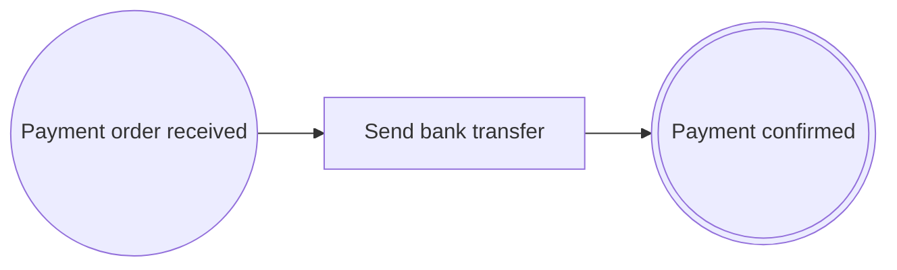

# Lesson 7. Messages between processes

> 🇪🇸 [Versión en español](../../es/curso/07-mensajes-entre-procesos.md)

**Goal:** have the approved claim start Treasury's payment process with a message, and have the payment finish by
publishing the confirmation when the bank confirms the transfer.

## What you will learn

- How two processes communicate: an end event that publishes a message and a start event that receives it.
- How to declare a message as a versioned contract (`@Message`, `@MessageVersion`, `MessageHeader`).
- How to publish and receive it with Spring events, and how to make receiving idempotent.
- When to publish with a send task (`@SendTask`) instead of an end event.
- How the contract is frozen in `pac/message-contracts.lock` and what happens if you change it.

## Starting point

The code from [lesson 6](06-waiting-tasks.md): `ExpenseClaimProcess` ends at `EXP-PAYMENT-ORDERED` with a normal
outcome, claims are stored in `ExpenseClaims` and `ClaimController` exposes submission and approval.

## Steps

### 1. Why a second process

Paying is not the claims process's business: Treasury does it, with its own rules and at its own pace. That is why
payment will be another process, `EXP-PAYMENT`, which starts when a payment order reaches it.

In `bpmncode` processes only communicate through **messages**: one publishes the message, when it ends at a
`@MessageEndEvent(messageRef = …)` or in the middle of the process at a `@SendTask(messageRef = …)`, and the other
starts at a `@MessageStartEvent` that receives it. The library **does not transport** messages: they are published
with Spring's `ApplicationEventPublisher` and received with a listener. What it provides is the contract, the check of
both ends and the evidence.

The new process:



After sending the transfer, the instance waits at `PAY-TRANSFER` until the bank confirms. The bank's confirmation is
not a process of your application, so it cannot be a `bpmncode` message (every message start event needs a process
that publishes it). It arrives through an HTTP *webhook* that completes the process, and that is when `EXP-PAYMENT`
publishes its own message, the payment confirmation.

### 2. Declare the messages

A message is a contract between two processes that evolve separately, so it is versioned from the start:

- `@Message` goes on a `sealed interface` (the **family**) that extends `ProcessMessage`.
- Each version is a `record` with `@MessageVersion(n)` that implements the family. Its first component is the header
  `MessageHeader header`, common to all messages.

`src/main/java/com/example/expenses/claim/PaymentOrdered.java`:

```java
package com.example.expenses.claim;

import java.util.UUID;

import io.github.eldiegos.bpmncode.annotation.Message;
import io.github.eldiegos.bpmncode.runtime.ProcessMessage;

@Message(id = "EV-EXP-PAYMENT-ORDERED", name = "Expense payment ordered")
public sealed interface PaymentOrdered extends ProcessMessage permits PaymentOrderedV1 {

	UUID claimId();
}
```

`src/main/java/com/example/expenses/claim/PaymentOrderedV1.java`:

```java
package com.example.expenses.claim;

import java.math.BigDecimal;
import java.util.UUID;

import io.github.eldiegos.bpmncode.annotation.MessageVersion;
import io.github.eldiegos.bpmncode.runtime.MessageHeader;

@MessageVersion(1)
public record PaymentOrderedV1(MessageHeader header, UUID claimId, BigDecimal amount) implements PaymentOrdered {
}
```

If a message is only going to have one version, `@Message` can go directly on the record. That is the case of the
confirmation:

`src/main/java/com/example/expenses/claim/PaymentConfirmed.java`:

```java
package com.example.expenses.claim;

import java.util.UUID;

import io.github.eldiegos.bpmncode.annotation.Message;
import io.github.eldiegos.bpmncode.runtime.MessageHeader;
import io.github.eldiegos.bpmncode.runtime.ProcessMessage;

@Message(id = "EV-EXP-PAYMENT-CONFIRMED", name = "Expense payment confirmed")
public record PaymentConfirmed(MessageHeader header, UUID claimId, String bankReference) implements ProcessMessage {
}
```

Both messages live in the `claim` package: the claims module defines the contracts and Treasury depends on it, never
the other way round. In lesson 12 Spring Modulith will check it.

### 3. Publish when the claim finishes

`EXP-PAYMENT-ORDERED` becomes a **message end event**. Just as starting by message has its own annotation
(`@MessageStartEvent`), so does the end that publishes a message: `@MessageEndEvent`, which replaces its `@EndEvent`
and declares which version it publishes (`messageRef = PaymentOrderedV1.class`, never the family). `@EndEvent` remains
the plain end, without `messageRef`, like `EXP-REJECTED`.

To publish the payment order:

1. `journal.messageHeader(instance)` prepares the header: delivery id, the instance's correlation, timestamp and
   source. Do not build it by hand.
2. `journal.reachEndEvent(instance, id, message)` checks that the message is the declared version and that its header
   belongs to this instance, completes the instance and records `MESSAGE_PUBLISHED`.
3. `events.publishEvent(message)` delivers it to the listeners.

Record **before** publishing: if conformance rejects the step, the message never goes out.

The complete `src/main/java/com/example/expenses/claim/ExpenseClaimProcess.java`:

```java
package com.example.expenses.claim;

import java.util.UUID;

import org.springframework.context.ApplicationEventPublisher;
import org.springframework.stereotype.Service;

import io.github.eldiegos.bpmncode.annotation.BusinessRuleTask;
import io.github.eldiegos.bpmncode.annotation.EndEvent;
import io.github.eldiegos.bpmncode.annotation.ExclusiveGateway;
import io.github.eldiegos.bpmncode.annotation.MessageEndEvent;
import io.github.eldiegos.bpmncode.annotation.Process;
import io.github.eldiegos.bpmncode.annotation.SequenceFlow;
import io.github.eldiegos.bpmncode.annotation.ServiceTask;
import io.github.eldiegos.bpmncode.annotation.StartEvent;
import io.github.eldiegos.bpmncode.annotation.UserTask;
import io.github.eldiegos.bpmncode.model.ProcessDefinitionRef;
import io.github.eldiegos.bpmncode.runtime.CorrelationKey;
import io.github.eldiegos.bpmncode.runtime.FlowNodeOutcome;
import io.github.eldiegos.bpmncode.runtime.ProcessInstanceRef;
import io.github.eldiegos.bpmncode.runtime.ProcessJournal;

@Service
@Process(id = ExpenseClaimProcess.PROCESS_ID, name = "Expense claim", version = 1,
		documentation = "An employee claims an expense; large amounts need the approval of a manager before payment.")
public class ExpenseClaimProcess {

	public static final String PROCESS_ID = "EXP-CLAIM";
	public static final String SUBMITTED = "EXP-SUBMITTED";
	public static final String CHECK = "EXP-CHECK";
	public static final String ROUTE = "EXP-ROUTE";
	public static final String APPROVE = "EXP-APPROVE";
	public static final String DECISION = "EXP-DECISION";
	public static final String PAY = "EXP-PAY";
	public static final String PAYMENT_ORDERED = "EXP-PAYMENT-ORDERED";
	public static final String REJECTED = "EXP-REJECTED";

	static final ProcessDefinitionRef KEY = ProcessDefinitionRef.of(PROCESS_ID, 1);

	public enum Route { NON_COMPLIANT, NEEDS_APPROVAL, AUTO_APPROVED }

	public enum Decision { APPROVED, REJECTED }

	private final ProcessJournal journal;
	private final ExpenseClaims claims;
	private final ApplicationEventPublisher events;

	ExpenseClaimProcess(ProcessJournal journal, ExpenseClaims claims, ApplicationEventPublisher events) {
		this.journal = journal;
		this.claims = claims;
		this.events = events;
	}

	@StartEvent(id = SUBMITTED, name = "Claim submitted", outgoing = @SequenceFlow(targetRef = CHECK))
	public ProcessInstanceRef submit(ExpenseClaim claim) {
		claims.save(claim);
		var instance = journal.startProcessInstance(KEY, CorrelationKey.of(claim.id()), FlowNodeOutcome.of("SUBMITTED"));
		journal.setBusinessKey(instance, "claim:" + claim.id());
		var compliant = check(instance, claim);
		switch (route(instance, claim, compliant)) {
			case NON_COMPLIANT -> reject(instance, "NON_COMPLIANT");
			case AUTO_APPROVED -> pay(instance, claim);
			case NEEDS_APPROVAL -> {
				// The instance waits at EXP-APPROVE until the manager decides.
			}
		}
		return instance;
	}

	@BusinessRuleTask(id = CHECK, name = "Check claim against policy", businessRuleRefs = ExpensePolicyRule.ID,
			outgoing = @SequenceFlow(targetRef = ROUTE))
	boolean check(ProcessInstanceRef instance, ExpenseClaim claim) {
		var compliant = ExpensePolicyRule.complies(claim);
		journal.completeActivity(instance, CHECK, compliant ? FlowNodeOutcome.of("COMPLIANT")
				: FlowNodeOutcome.of("RULES_VIOLATED", "R-EXP-001@1"));
		return compliant;
	}

	@ExclusiveGateway(id = ROUTE, name = "Needs approval?", businessRuleRefs = ApprovalThresholdRule.ID,
			outgoing = {
					@SequenceFlow(when = "NON_COMPLIANT", targetRef = REJECTED, name = "Not compliant"),
					@SequenceFlow(when = "NEEDS_APPROVAL", targetRef = APPROVE, name = "Above threshold",
							conditionExpression = "Amount > 1,000 EUR"),
					@SequenceFlow(when = "AUTO_APPROVED", targetRef = PAY, name = "Within threshold") })
	Route route(ProcessInstanceRef instance, ExpenseClaim claim, boolean compliant) {
		Route route;
		if (!compliant) {
			route = Route.NON_COMPLIANT;
		}
		else if (ApprovalThresholdRule.needsApproval(claim.amount())) {
			route = Route.NEEDS_APPROVAL;
		}
		else {
			route = Route.AUTO_APPROVED;
		}
		return journal.selectSequenceFlow(instance, ROUTE, route);
	}

	@UserTask(id = APPROVE, name = "Approve claim", outgoing = @SequenceFlow(targetRef = DECISION))
	public void approve(UUID claimId, Decision decision) {
		var claim = claims.find(claimId).orElseThrow();
		var instance = journal.require(PROCESS_ID, CorrelationKey.of(claimId));
		journal.completeActivity(instance, APPROVE, FlowNodeOutcome.of("DECIDED", decision.name()));
		switch (decide(instance, decision)) {
			case APPROVED -> pay(instance, claim);
			case REJECTED -> reject(instance, "REJECTED_BY_MANAGER");
		}
	}

	@ExclusiveGateway(id = DECISION, name = "Approved?",
			outgoing = {
					@SequenceFlow(when = "APPROVED", targetRef = PAY, name = "Yes"),
					@SequenceFlow(when = "REJECTED", targetRef = REJECTED, name = "No") })
	Decision decide(ProcessInstanceRef instance, Decision decision) {
		return journal.selectSequenceFlow(instance, DECISION, decision);
	}

	@ServiceTask(id = PAY, name = "Order payment", outgoing = @SequenceFlow(targetRef = PAYMENT_ORDERED))
	void pay(ProcessInstanceRef instance, ExpenseClaim claim) {
		journal.completeActivity(instance, PAY, FlowNodeOutcome.of("PAYMENT_ORDERED"));
		paymentOrdered(instance, claim);
	}

	@MessageEndEvent(id = PAYMENT_ORDERED, name = "Payment ordered", messageRef = PaymentOrderedV1.class)
	void paymentOrdered(ProcessInstanceRef instance, ExpenseClaim claim) {
		var message = new PaymentOrderedV1(journal.messageHeader(instance), claim.id(), claim.amount());
		journal.reachEndEvent(instance, PAYMENT_ORDERED, message);
		events.publishEvent(message);
	}

	@EndEvent(id = REJECTED, name = "Claim rejected")
	void reject(ProcessInstanceRef instance, String reason) {
		journal.reachEndEvent(instance, REJECTED, FlowNodeOutcome.of(reason));
	}
}
```

Compared with lesson 6, the constructor (it receives `ApplicationEventPublisher`), `paymentOrdered` (now with
`@MessageEndEvent`) and the imports (`MessageEndEvent`) change.

**Publishing without ending: the send task.** The claim has nothing else to do after ordering the payment, so it
publishes the order when it ends. If it had to carry on (for example, to wait for the confirmation itself), `EXP-PAY`
would be a send task (`@SendTask`): it publishes the message and the instance carries on without waiting for a reply.
For reference only, do not add it to the project:

```java
@SendTask(id = PAY, name = "Order payment", messageRef = PaymentOrderedV1.class,
		outgoing = @SequenceFlow(targetRef = …))
void pay(ProcessInstanceRef instance, ExpenseClaim claim) {
	var message = new PaymentOrderedV1(journal.messageHeader(instance), claim.id(), claim.amount());
	journal.completeActivity(instance, PAY, message);   // MESSAGE_PUBLISHED EV-EXP-PAYMENT-ORDERED@1 <messageId>
	events.publishEvent(message);
	// the instance carries on to the next node
}
```

It is completed with `completeActivity(instance, id, message)`, which checks the version and the header just like
`reachEndEvent`; with a `FlowNodeOutcome` conformance rejects it (`EXP-PAY sends EV-EXP-PAYMENT-ORDERED@1: complete
it with completeActivity(instance, sendTaskId, message)`). The message flow in the diagram would leave from the task,
not from the end event.

### 4. The payment process

The `@MessageStartEvent` method has to be a Spring listener (`@EventListener`, or an annotation that carries it) whose
parameter is the message. `messageRef = PaymentOrdered.class` (the family) accepts all its versions.

Two important details:

- **The correlation travels in the header.** The payment instance inherits the message's correlation, that is, the
  claim id. That is why `journal.require("EXP-PAYMENT", CorrelationKey.of(claimId))` finds it later.
- **Deliveries can repeat.** With "at least once" delivery, the same message can arrive twice.
  `startProcessInstanceIfAbsent` does not start a second instance: it returns `ProcessStart.Started` with the new one
  or `ProcessStart.AlreadyStarted` with the existing one.

Versions are handled with a `switch` **without `default`**: if one day you add `PaymentOrderedV2` to the sealed
family, this code will stop compiling until you decide what to do with it.

`src/main/java/com/example/expenses/payment/ExpensePaymentProcess.java`:

```java
package com.example.expenses.payment;

import java.util.UUID;

import org.slf4j.Logger;
import org.slf4j.LoggerFactory;
import org.springframework.context.ApplicationEventPublisher;
import org.springframework.context.event.EventListener;
import org.springframework.stereotype.Service;

import com.example.expenses.claim.PaymentConfirmed;
import com.example.expenses.claim.PaymentOrdered;
import com.example.expenses.claim.PaymentOrderedV1;

import io.github.eldiegos.bpmncode.annotation.MessageEndEvent;
import io.github.eldiegos.bpmncode.annotation.MessageStartEvent;
import io.github.eldiegos.bpmncode.annotation.Process;
import io.github.eldiegos.bpmncode.annotation.SequenceFlow;
import io.github.eldiegos.bpmncode.annotation.ServiceTask;
import io.github.eldiegos.bpmncode.model.ProcessDefinitionRef;
import io.github.eldiegos.bpmncode.runtime.CorrelationKey;
import io.github.eldiegos.bpmncode.runtime.FlowNodeOutcome;
import io.github.eldiegos.bpmncode.runtime.ProcessInstanceRef;
import io.github.eldiegos.bpmncode.runtime.ProcessJournal;
import io.github.eldiegos.bpmncode.runtime.ProcessStart;

@Service
@Process(id = ExpensePaymentProcess.PROCESS_ID, name = "Expense payment", version = 1,
		documentation = "Treasury pays an approved claim and waits for the bank to confirm the transfer.")
public class ExpensePaymentProcess {

	public static final String PROCESS_ID = "EXP-PAYMENT";
	public static final String ORDER_RECEIVED = "PAY-ORDER-RECEIVED";
	public static final String TRANSFER = "PAY-TRANSFER";
	public static final String CONFIRMED = "PAY-CONFIRMED";

	static final ProcessDefinitionRef KEY = ProcessDefinitionRef.of(PROCESS_ID, 1);

	private static final Logger log = LoggerFactory.getLogger(ExpensePaymentProcess.class);

	private final ProcessJournal journal;
	private final ApplicationEventPublisher events;

	ExpensePaymentProcess(ProcessJournal journal, ApplicationEventPublisher events) {
		this.journal = journal;
		this.events = events;
	}

	@EventListener
	@MessageStartEvent(id = ORDER_RECEIVED, name = "Payment order received", messageRef = PaymentOrdered.class,
			outgoing = @SequenceFlow(targetRef = TRANSFER))
	public void on(PaymentOrdered order) {
		switch (journal.startProcessInstanceIfAbsent(KEY, order, FlowNodeOutcome.of("ORDER_RECEIVED"))) {
			case ProcessStart.Started started -> transfer(started.instance(), order);
			case ProcessStart.AlreadyStarted repeated -> log.info("Payment order for claim {} already received",
					order.claimId());
		}
	}

	@ServiceTask(id = TRANSFER, name = "Send bank transfer", outgoing = @SequenceFlow(targetRef = CONFIRMED))
	void transfer(ProcessInstanceRef instance, PaymentOrdered order) {
		var amount = switch (order) {
			case PaymentOrderedV1 v1 -> v1.amount();
		};
		log.info("Bank transfer of {} EUR sent for claim {}", amount, order.claimId());
		journal.completeActivity(instance, TRANSFER, FlowNodeOutcome.of("TRANSFER_SENT"));
	}

	@MessageEndEvent(id = CONFIRMED, name = "Payment confirmed", messageRef = PaymentConfirmed.class)
	public void confirm(UUID claimId, String bankReference) {
		var instance = journal.require(PROCESS_ID, CorrelationKey.of(claimId));
		var confirmation = new PaymentConfirmed(journal.messageHeader(instance), claimId, bankReference);
		journal.reachEndEvent(instance, CONFIRMED, confirmation);
		events.publishEvent(confirmation);
	}
}
```

If you prefer not to deal with idempotency, there is `journal.startProcessInstance(KEY, order)`: it starts the
instance and records the outcome `MESSAGE_RECEIVED` with the received version, but a second delivery would throw
`DuplicateProcessInstanceException`.

### 5. The bank's webhook

`confirm` is an end event that waits, just like the approval: the bank calls it whenever it sees fit.

`src/main/java/com/example/expenses/payment/BankWebhookController.java`:

```java
package com.example.expenses.payment;

import java.util.UUID;

import org.springframework.http.HttpStatus;
import org.springframework.web.bind.annotation.PathVariable;
import org.springframework.web.bind.annotation.PostMapping;
import org.springframework.web.bind.annotation.RequestBody;
import org.springframework.web.bind.annotation.ResponseStatus;
import org.springframework.web.bind.annotation.RestController;

@RestController
class BankWebhookController {

	record BankConfirmation(String bankReference) {
	}

	private final ExpensePaymentProcess payments;

	BankWebhookController(ExpensePaymentProcess payments) {
		this.payments = payments;
	}

	@PostMapping("/bank/confirmations/{claimId}")
	@ResponseStatus(HttpStatus.NO_CONTENT)
	void confirmed(@PathVariable UUID claimId, @RequestBody BankConfirmation confirmation) {
		payments.confirm(claimId, confirmation.bankReference());
	}
}
```

### 6. Who listens to the confirmation

The confirmation does not start any process: a normal listener in the claims module listens to it, and here it only
writes a line to the log (in a real application it would notify the employee). Publishing a message that no process
consumes is allowed.

`src/main/java/com/example/expenses/claim/ClaimNotifications.java`:

```java
package com.example.expenses.claim;

import org.slf4j.Logger;
import org.slf4j.LoggerFactory;
import org.springframework.context.event.EventListener;
import org.springframework.stereotype.Component;

@Component
class ClaimNotifications {

	private static final Logger log = LoggerFactory.getLogger(ClaimNotifications.class);

	@EventListener
	void on(PaymentConfirmed confirmation) {
		log.info("Claim {} paid (bank reference {})", confirmation.claimId(), confirmation.bankReference());
	}
}
```

### 7. Freeze the contracts

At startup, `bpmncode` generates a JSON Schema for each message version and computes its SHA-256 fingerprint. If the
application has the file `pac/message-contracts.lock`, it compares each version with the frozen fingerprint: that way
nobody changes a published contract without noticing. Without the file nothing is checked, so create it now, with just
a comment:

`src/main/resources/pac/message-contracts.lock`:

```
# Frozen contracts of the messages between processes.
```

Start the application. It does not start, and it tells you exactly which lines to add:

```
Invalid process model (2 problem(s)):
  - [MESSAGE_CONTRACT_NOT_LOCKED] Message com.example.expenses.claim.PaymentConfirmed: EV-EXP-PAYMENT-CONFIRMED@1 is not frozen in pac/message-contracts.lock; add the line: EV-EXP-PAYMENT-CONFIRMED@1 = sha256:a803827cc6ed81506dfa9fa8e0a2c08887fe13c5e0f0b00684eb5a9c93eb3ab7
  - [MESSAGE_CONTRACT_NOT_LOCKED] Message com.example.expenses.claim.PaymentOrderedV1: EV-EXP-PAYMENT-ORDERED@1 is not frozen in pac/message-contracts.lock; add the line: EV-EXP-PAYMENT-ORDERED@1 = sha256:007720056f0bb698316584c3e627fc68e4cbd20d3b29a98fa358f1fed627ec24
```

Copy them into the file (if your records are identical to the course's, the fingerprints match):

```
# Frozen contracts of the messages between processes.
EV-EXP-PAYMENT-CONFIRMED@1 = sha256:a803827cc6ed81506dfa9fa8e0a2c08887fe13c5e0f0b00684eb5a9c93eb3ab7
EV-EXP-PAYMENT-ORDERED@1 = sha256:007720056f0bb698316584c3e627fc68e4cbd20d3b29a98fa358f1fed627ec24
```

This file goes into version control, like any contract.

### 8. Adjust the test

The last step of a paid claim no longer records your `COMPLETED` outcome: a message end event records
`MESSAGE_PUBLISHED` with the published version. In `aSmallClaimIsPaidStraightAway`, change the last assertion:

```java
		assertThat(history.flowNodeInstances(instance.instanceId()))
				.extracting(step -> step.outcome().toString())
				.containsExactly("SUBMITTED", "COMPLIANT", "SEQUENCE_FLOW_SELECTED:AUTO_APPROVED → EXP-PAY",
						"PAYMENT_ORDERED", "MESSAGE_PUBLISHED:EV-EXP-PAYMENT-ORDERED@1");
```

## Check that it works

`./mvnw test` passes. Start the application. The log shows both processes:

```
Process definition EXP-CLAIM v1 'Expense claim': 8 flow nodes, 9 sequence flows
Process definition EXP-PAYMENT v1 'Expense payment': 3 flow nodes, 2 sequence flows
```

Submit a large claim, approve it and confirm the transfer (replace `$CLAIM` with the returned `claimId`):

```bash
curl -s -XPOST localhost:8080/claims -H 'Content-Type: application/json' \
     -d '{"employee":"E-1042","amount":1800,"receiptsAttached":true}'
curl -s -XPOST localhost:8080/claims/$CLAIM/approval -H 'Content-Type: application/json' -d '{"decision":"APPROVED"}'
curl -s localhost:8080/claims/$CLAIM/instances
```

The correlation now returns **two** instances: `EXP-CLAIM`, completed with `publishedMessage`
`EV-EXP-PAYMENT-ORDERED@1`, and `EXP-PAYMENT`, active at `PAY-TRANSFER` with `nextFlowNodeIds` `["PAY-CONFIRMED"]` and
a `triggeringMessage` whose `sourceInstanceId` is the claim's instance.

```bash
curl -s -XPOST localhost:8080/bank/confirmations/$CLAIM -H 'Content-Type: application/json' \
     -d '{"bankReference":"TRF-2026-0001"}' -w '%{http_code}\n'
```

It responds `204`, and in the log you see the whole chain:

```
Process instance 981e762a-… of EXP-CLAIM completed at EXP-PAYMENT-ORDERED publishing EV-EXP-PAYMENT-ORDERED@1 0c103f39-…
Process instance 788b7589-… of EXP-PAYMENT v1 started (correlation 43c32dc6-…)
Process instance 788b7589-… of EXP-PAYMENT v1 started by EV-EXP-PAYMENT-ORDERED@1 0c103f39-… from instance 981e762a-…
Bank transfer of 1800 EUR sent for claim 43c32dc6-…
Process instance 788b7589-… of EXP-PAYMENT completed at PAY-CONFIRMED publishing EV-EXP-PAYMENT-CONFIRMED@1 5786382c-…
Claim 43c32dc6-… paid (bank reference TRF-2026-0001)
```

Finally, request `/bpmn/COLLABORATION`: it is a new diagram with both pools and the message flow
`MessageFlow_EXP-PAYMENT-ORDERED_PAY-ORDER-RECEIVED` between them.

## Common mistakes

- **The `@MessageStartEvent` is not a listener** (`@EventListener` is missing). It does not compile:

  ```
  a message start event with messageRef PaymentOrdered requires the method to be a Spring event listener receiving that type
  ```

- **Putting `messageRef` on an `@EndEvent`.** It does not compile: `@EndEvent` is the plain end and has no such
  attribute; the end event that publishes is `@MessageEndEvent`.
- **The end event publishes the family** (`messageRef = PaymentOrdered.class`). It does not compile:

  ```
  an end event publishes one concrete version: use one of the @MessageVersion records of PaymentOrdered as messageRef
  ```

- **Reaching the message end event with an outcome** (`reachEndEvent(instance, PAYMENT_ORDERED, FlowNodeOutcome.of("…"))`):

  ```
  EXP-PAYMENT-ORDERED publishes EV-EXP-PAYMENT-ORDERED: reach it with reachEndEvent(instance, endEventId, message)
  ```

- **Changing a record that is already frozen** (e.g. adding `String currency` to `PaymentOrderedV1`). The application
  does not start:

  ```
  [MESSAGE_CONTRACT_CHANGED] Message com.example.expenses.claim.PaymentOrderedV1: the contract of EV-EXP-PAYMENT-ORDERED@1 changed (frozen sha256:0077…, now sha256:b3ff…): a published version never changes, declare a new @MessageVersion instead
  ```

  A published version never changes: create `PaymentOrderedV2` (you will do it in the exercise of lesson 9).
- **A process that waits for a message nobody publishes** (e.g. a `@MessageStartEvent` for a confirmation sent by an
  external system): `UNKNOWN_MESSAGE_REF` with `no process publishes the message … that starts this process`. What
  comes from outside enters through a normal call, like the webhook.

## Exercise

Call the webhook twice with the same confirmation. The second call responds `500`, because conformance rejects the step
(`Process instance … is already completed`); because you record before publishing, the confirmation is not published
twice. Make the webhook respond `409 Conflict` without reaching the journal.

<details><summary>Solution</summary>

Check whose turn it is, as you did with the approval: the payment has to be waiting at `PAY-CONFIRMED`.

```java
	private final ExpensePaymentProcess payments;
	private final ProcessJournal journal;
	private final ProcessInstanceHistory history;

	BankWebhookController(ExpensePaymentProcess payments, ProcessJournal journal, ProcessInstanceHistory history) {
		this.payments = payments;
		this.journal = journal;
		this.history = history;
	}

	@PostMapping("/bank/confirmations/{claimId}")
	@ResponseStatus(HttpStatus.NO_CONTENT)
	void confirmed(@PathVariable UUID claimId, @RequestBody BankConfirmation confirmation) {
		var waiting = journal.resume(ExpensePaymentProcess.PROCESS_ID, CorrelationKey.of(claimId))
				.map(instance -> history.isWaitingAt(instance.instanceId(), ExpensePaymentProcess.CONFIRMED))
				.orElse(false);
		if (!waiting) {
			throw new ResponseStatusException(HttpStatus.CONFLICT, "Payment of claim " + claimId + " is not waiting");
		}
		payments.confirm(claimId, confirmation.bankReference());
	}
```

New imports: `org.springframework.web.server.ResponseStatusException`,
`io.github.eldiegos.bpmncode.runtime.CorrelationKey`, `io.github.eldiegos.bpmncode.runtime.ProcessInstanceHistory` and
`io.github.eldiegos.bpmncode.runtime.ProcessJournal`.

</details>

## Learn more

- [Messages between processes](../messages.md): [versions as sealed types](../messages.md#1-versions-as-sealed-types),
  [frozen schema](../messages.md#2-frozen-schema) and [header](../messages.md#3-message-header).
- [`@MessageStartEvent`](../annotations.md#messagestartevent-started-by-a-message),
  [`@MessageEndEvent`](../annotations.md#messageendevent-end-publishing-a-message) and
  [`@SendTask`](../annotations.md#sendtask).
- [Transactions and idempotency](../execution.md#transactions-and-idempotency).

---

[← Previous: Waiting tasks](06-waiting-tasks.md) | [Index](README.md) | [Next: Persistence →](08-persistence.md)
