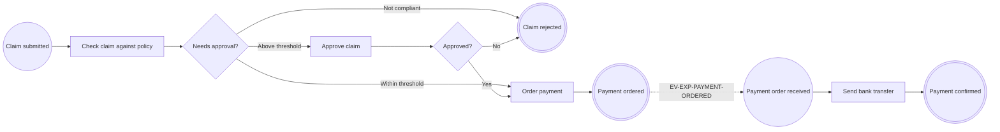

# bpmncode course

> 🇪🇸 [Versión en español](../../es/curso/README.md)

Learn to use `bpmncode` step by step, from an empty Spring Boot project to an application ready for production.

This course does not replace the [reference manual](../getting-started.md): it is a guided tour. Each lesson adds
a piece to the same application and points you to the manual when you want all the details.

## Who it is for

Java and Spring Boot developers who have never modelled processes *code-first*. You do not need to know BPMN: each
element is explained when it appears. You should know how to create a Spring Boot application, write a
`@RestController` and run tests with JUnit.

## Requirements

| | Version |
|---|---|
| Java | 21 or later (the library is compiled for 21 and also tested on 25) |
| Spring Boot | 4.1 (the course uses `spring-boot-starter-parent` 4.1.1, the version the library is built with) |
| Maven | whatever your project ships with; the examples use `./mvnw` |
| bpmncode | 0.1.0 |
| Tools | `curl` (or any HTTP client) and a browser to open the diagrams |

Lesson 8 adds an H2 database. You do not need to install anything else.

> If you build the library yourself (`./mvnw install` in this repository), its version is `0.1.0-SNAPSHOT`: use that
> number in your `pom.xml`.

## The example: an expense claim

The whole course builds **a single application**, `expenses`: the handling of an expense claim.

1. An employee submits the claim.
2. The claim is checked against the expense policy (it has receipts and a valid amount).
3. If the amount exceeds a threshold, a manager approves or rejects it. That task waits for days if needed.
4. The payment is ordered. Treasury makes the bank transfer and, when the bank confirms it, the payment confirmation
   is published.
5. Later the policy changes: version 2 of the process appears, with a lower threshold, while the old claims finish
   with version 1.

The names you will see in every lesson:

| What | Name |
|---|---|
| Root package | `com.example.expenses` |
| Claim process | `EXP-CLAIM`, classes `ExpenseClaimProcess` (v1) and `ExpenseClaimProcessV2` (v2) |
| Payment process | `EXP-PAYMENT`, class `ExpensePaymentProcess` |
| Nodes of `EXP-CLAIM` | `EXP-SUBMITTED`, `EXP-CHECK`, `EXP-ROUTE`, `EXP-APPROVE`, `EXP-DECISION`, `EXP-PAY`, `EXP-PAYMENT-ORDERED`, `EXP-REJECTED` |
| Nodes of `EXP-PAYMENT` | `PAY-ORDER-RECEIVED`, `PAY-TRANSFER`, `PAY-CONFIRMED` |
| Business rules | `R-EXP-001` (expense policy), `R-EXP-002` (approval threshold, versions 1 and 2) |
| Messages | `EV-EXP-PAYMENT-ORDERED` (payment ordered), `EV-EXP-PAYMENT-CONFIRMED` (payment confirmed) |

## How to follow it

- Do the lessons in order. Each one starts from **exactly** the code the previous one ended with; the
  "Starting point" section reminds you of it.
- Write the code yourself. The snippets are complete: if a class changes a lot, it is shown in full.
- At the end of each lesson, do what "Check that it works" says before moving on. If something fails, look at
  "Common mistakes": the messages you will see are the library's real ones.
- The exercises are optional. Their solution is folded; you do not need to apply it to continue with the next
  lesson, unless the lesson says so.
- The names of processes, nodes and rules are in English because they are the model's **canonical texts** (the ones
  that end up in the BPMN); in lesson 10 you will translate them. Code comments are in English.

## Lessons

| # | Lesson | What you learn |
|---|---|---|
| 1 | [Your first process and its diagram](01-first-process.md) | create the project, annotate a minimal process and see its BPMN |
| 2 | [Tasks, flows and business rules](02-tasks-and-rules.md) | the three task types, sequence flows and `@BusinessRule` |
| 3 | [Decisions with gateways](03-decisions-with-gateways.md) | branch the process with an `@ExclusiveGateway` that returns an `enum` |
| 4 | [Validation at compile time and at startup](04-validation.md) | which errors `javac` detects, which ones startup detects, and how to read them |
| 5 | [Running with the journal](05-running-with-the-journal.md) | record each step with `ProcessJournal`, outcomes, correlation and history |
| 6 | [Waiting tasks](06-waiting-tasks.md) | resume an instance days later to complete a human task |
| 7 | [Messages between processes](07-messages-between-processes.md) | start a process with a message, frozen contracts and idempotency |
| 8 | [Persistence: memory, JDBC and JPA](08-persistence.md) | store instances in a database and in the same transaction as your data |
| 9 | [Process and rule versions](09-versions.md) | publish version 2 without breaking running instances |
| 10 | [BPMN, traceability and i18n](10-bpmn-traceability-i18n.md) | read the exported XML, walk the traceability and translate the texts |
| 11 | [Statistics and web viewer](11-statistics-and-web-viewer.md) | heatmap, path of an instance and the built-in bpmn-js viewer |
| 12 | [Testing and production](12-testing-and-production.md) | `ProcessAssertions`, production configuration and Spring Modulith |

Start with [lesson 1](01-first-process.md).
