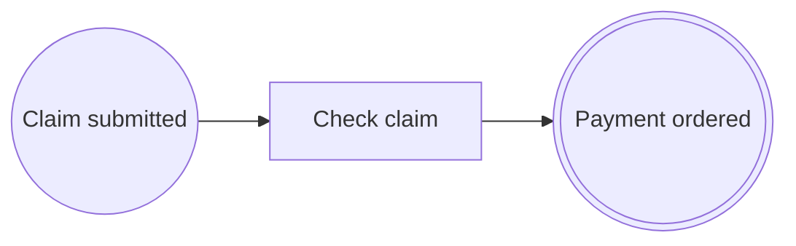

# Lección 1. Tu primer proceso y su diagrama

> 🇬🇧 [English version](../../en/course/01-first-process.md)

**Objetivo:** crear la aplicación `expenses`, declarar un proceso de tres pasos con anotaciones y ver su diagrama
BPMN 2.0 generado desde el código.

## Lo que vas a aprender

- Qué dependencias necesita una aplicación Spring Boot para usar `bpmncode`.
- Cómo se declara un proceso: una clase con `@Process` y un método anotado por cada paso.
- Cómo se unen los pasos con `@SequenceFlow` y por qué el orden de los métodos no importa.
- Qué hace la librería al arrancar y cómo exportar el diagrama con `BpmnDiagramService`.

## Punto de partida

Nada: empiezas con un directorio vacío. Si prefieres, genera un proyecto Maven con
[start.spring.io](https://start.spring.io) (Java 21, Spring Boot 4.1, dependencia *Spring Web*) y sustituye su
`pom.xml` por el del paso 1.

## Pasos

### 1. Crea el proyecto

`bpmncode` es una dependencia más. No trae motor de procesos ni base de datos obligatoria: sin base de datos, guarda
las instancias en memoria. Añade también su **procesador de anotaciones**, que revisa tus procesos mientras compilas
(lo verás a fondo en la [lección 4](04-validacion.md)). Desde JDK 23, `javac` ya no ejecuta los procesadores que
encuentra en el classpath, así que hay que nombrarlo.

`pom.xml`:

```xml
<?xml version="1.0" encoding="UTF-8"?>
<project xmlns="http://maven.apache.org/POM/4.0.0" xmlns:xsi="http://www.w3.org/2001/XMLSchema-instance"
	xsi:schemaLocation="http://maven.apache.org/POM/4.0.0 https://maven.apache.org/xsd/maven-4.0.0.xsd">
	<modelVersion>4.0.0</modelVersion>

	<parent>
		<groupId>org.springframework.boot</groupId>
		<artifactId>spring-boot-starter-parent</artifactId>
		<version>4.1.1</version>
		<relativePath/>
	</parent>

	<groupId>com.example</groupId>
	<artifactId>expenses</artifactId>
	<version>0.0.1-SNAPSHOT</version>

	<properties>
		<java.version>21</java.version>
		<bpmncode.version>0.1.0</bpmncode.version>
	</properties>

	<dependencies>
		<dependency>
			<groupId>org.springframework.boot</groupId>
			<artifactId>spring-boot-starter-webmvc</artifactId>
		</dependency>
		<dependency>
			<groupId>io.github.eldiegos</groupId>
			<artifactId>bpmncode</artifactId>
			<version>${bpmncode.version}</version>
		</dependency>
		<dependency>
			<groupId>org.springframework.boot</groupId>
			<artifactId>spring-boot-starter-test</artifactId>
			<scope>test</scope>
		</dependency>
	</dependencies>

	<build>
		<plugins>
			<plugin>
				<groupId>org.apache.maven.plugins</groupId>
				<artifactId>maven-compiler-plugin</artifactId>
				<configuration>
					<annotationProcessors>
						<annotationProcessor>io.github.eldiegos.bpmncode.processor.ProcessAnnotationProcessor</annotationProcessor>
					</annotationProcessors>
				</configuration>
			</plugin>
			<plugin>
				<groupId>org.springframework.boot</groupId>
				<artifactId>spring-boot-maven-plugin</artifactId>
			</plugin>
		</plugins>
	</build>
</project>
```

Si tu proyecto ya usa otros procesadores (Lombok, MapStruct…), lístalos todos en `annotationProcessors`: al nombrar
uno, `javac` deja de buscar los demás.

### 2. La clase de la aplicación

La librería busca los procesos en el paquete de la clase `@SpringBootApplication` y sus subpaquetes, igual que Spring
busca tus componentes. No hay que activar nada.

`src/main/java/com/example/expenses/ExpensesApplication.java`:

```java
package com.example.expenses;

import org.springframework.boot.SpringApplication;
import org.springframework.boot.autoconfigure.SpringBootApplication;

@SpringBootApplication
public class ExpensesApplication {

	public static void main(String[] args) {
		SpringApplication.run(ExpensesApplication.class, args);
	}
}
```

### 3. El dato de negocio

La solicitud es un record normal. El proceso no la guarda: tus datos siguen siendo tuyos.

`src/main/java/com/example/expenses/claim/ExpenseClaim.java`:

```java
package com.example.expenses.claim;

import java.math.BigDecimal;
import java.util.UUID;

public record ExpenseClaim(UUID id, String employee, BigDecimal amount, boolean receiptsAttached) {
}
```

### 4. El proceso

Un proceso es una clase con `@Process`. Cada **nodo de flujo** (un evento, una tarea, una decisión) es un método
anotado. Esta primera versión tiene tres:

- `@StartEvent`: donde empieza el proceso. Este se inicia con una llamada de tu código.
- `@ServiceTask`: un trabajo que hace el sistema, aquí comprobar la solicitud.
- `@EndEvent`: donde termina.

Cada nodo (salvo los de fin) declara su flujo de salida con `outgoing = @SequenceFlow(targetRef = "…")`, el id del
nodo al que lleva. Por eso **el orden de los métodos en la clase no importa**: el grafo sale de los `targetRef`, no de
la posición.

`src/main/java/com/example/expenses/claim/ExpenseClaimProcess.java`:

```java
package com.example.expenses.claim;

import org.springframework.stereotype.Service;

import io.github.eldiegos.bpmncode.annotation.EndEvent;
import io.github.eldiegos.bpmncode.annotation.Process;
import io.github.eldiegos.bpmncode.annotation.SequenceFlow;
import io.github.eldiegos.bpmncode.annotation.ServiceTask;
import io.github.eldiegos.bpmncode.annotation.StartEvent;

@Service
@Process(id = "EXP-CLAIM", name = "Expense claim", version = 1,
		documentation = "An employee claims an expense; large amounts need the approval of a manager before payment.")
public class ExpenseClaimProcess {

	@StartEvent(id = "EXP-SUBMITTED", name = "Claim submitted", outgoing = @SequenceFlow(targetRef = "EXP-CHECK"))
	public void submit(ExpenseClaim claim) {
		check(claim);
		paymentOrdered(claim);
	}

	@ServiceTask(id = "EXP-CHECK", name = "Check claim", outgoing = @SequenceFlow(targetRef = "EXP-PAYMENT-ORDERED"))
	void check(ExpenseClaim claim) {
		// La comprobación real llega en la lección 2.
	}

	@EndEvent(id = "EXP-PAYMENT-ORDERED", name = "Payment ordered")
	void paymentOrdered(ExpenseClaim claim) {
	}
}
```

Fíjate en tres cosas:

- **Los ids** (`EXP-CLAIM`, `EXP-SUBMITTED`…) son estables y únicos en toda la aplicación. Acaban como ids XML del
  BPMN, así que empiezan por letra o `_` y no llevan espacios. El prefijo `EXP-` evita choques con otros procesos.
- **`name`** es obligatorio: es el texto canónico que se ve en el diagrama. Se recomienda en inglés y se traduce
  aparte (lección 10).
- **Las anotaciones no ejecutan nada.** Describen el proceso. Quien llama a `check` y a `paymentOrdered` es tu código,
  como siempre. En la lección 5 harás que cada paso deje constancia.

### 5. Arranca la aplicación

```bash
./mvnw spring-boot:run
```

Al arrancar, `bpmncode` busca las clases anotadas, construye el modelo y lo valida. Si algo no encaja, la aplicación
no arranca (lección 4). Si todo va bien, verás estas líneas en el log:

```
i.g.e.b.model.ProcessDefinitionRegistry  : Process definition EXP-CLAIM v1 'Expense claim': 3 flow nodes, 2 sequence flows
.g.e.b.r.ProcessRuntimeAutoConfiguration : Process instances are stored with InMemoryProcessInstanceStore
```

La primera dice que ha encontrado tu proceso; la segunda, que las instancias irán a memoria porque no hay base de
datos.

### 6. Expón el diagrama

El diagrama no se dibuja a mano: se deriva del modelo. `BpmnDiagramService` es un bean que la librería registra sola.
`diagram(id)` busca un diagrama por su id (el de un proceso es el id del proceso) y `xml(…)` genera el documento
BPMN 2.0. `LabelResolver.CANONICAL` deja los textos tal cual los escribiste.

`src/main/java/com/example/expenses/DiagramController.java`:

```java
package com.example.expenses;

import org.springframework.http.HttpStatus;
import org.springframework.http.MediaType;
import org.springframework.web.bind.annotation.GetMapping;
import org.springframework.web.bind.annotation.PathVariable;
import org.springframework.web.bind.annotation.RestController;
import org.springframework.web.server.ResponseStatusException;

import io.github.eldiegos.bpmncode.bpmn.BpmnDiagramService;
import io.github.eldiegos.bpmncode.i18n.LabelResolver;

@RestController
class DiagramController {

	private final BpmnDiagramService diagrams;

	DiagramController(BpmnDiagramService diagrams) {
		this.diagrams = diagrams;
	}

	@GetMapping(value = "/bpmn/{id}", produces = MediaType.APPLICATION_XML_VALUE)
	String bpmn(@PathVariable String id) {
		var diagram = diagrams.diagram(id).orElseThrow(() -> new ResponseStatusException(HttpStatus.NOT_FOUND));
		return diagrams.xml(diagram, "en", LabelResolver.CANONICAL);
	}
}
```

El segundo argumento de `xml` es el idioma: la librería guarda en caché un documento por diagrama e idioma.

## Comprueba que funciona

Reinicia la aplicación y pide el diagrama:

```bash
curl -s localhost:8080/bpmn/EXP-CLAIM > expense-claim.bpmn
```

El fichero empieza así (abreviado):

```xml
<bpmn:definitions … exporter="bpmncode" id="Definitions_EXP-CLAIM" targetNamespace="https://pac.dev/process/EXP-CLAIM">
  <bpmn:process id="EXP-CLAIM" isExecutable="false" name="Expense claim" pac:version="1">
    <bpmn:startEvent id="EXP-SUBMITTED" name="Claim submitted">
      <bpmn:extensionElements>
        <pac:implementation class="com.example.expenses.claim.ExpenseClaimProcess" method="submit(ExpenseClaim)"/>
      </bpmn:extensionElements>
      <bpmn:outgoing>Flow_EXP-SUBMITTED_EXP-CHECK</bpmn:outgoing>
    </bpmn:startEvent>
    <bpmn:serviceTask id="EXP-CHECK" name="Check claim">…</bpmn:serviceTask>
    <bpmn:endEvent id="EXP-PAYMENT-ORDERED" name="Payment ordered">…</bpmn:endEvent>
    <bpmn:sequenceFlow id="Flow_EXP-SUBMITTED_EXP-CHECK" sourceRef="EXP-SUBMITTED" targetRef="EXP-CHECK"/>
    <bpmn:sequenceFlow id="Flow_EXP-CHECK_EXP-PAYMENT-ORDERED" sourceRef="EXP-CHECK" targetRef="EXP-PAYMENT-ORDERED"/>
  </bpmn:process>
  <bpmndi:BPMNDiagram id="Diagram_EXP-CLAIM">…</bpmndi:BPMNDiagram>
</bpmn:definitions>
```

Abre [demo.bpmn.io](https://demo.bpmn.io) y arrastra el fichero: verás tres nodos de izquierda a derecha.



Observa dos cosas del XML:

- Los flujos tienen id aunque no lo escribiste: por defecto es `Flow_<origen>_<destino>`.
- `pac:implementation` dice qué clase y qué método implementan cada nodo. BPMN no tiene dónde guardar eso, así que va
  en una extensión `pac:`. Es la base de la trazabilidad (lección 10).

## Errores frecuentes

- **`curl` devuelve 404.** El id no es el de un diagrama. Prueba exactamente `EXP-CLAIM` (mayúsculas incluidas).
- **No aparece la línea `Process definition EXP-CLAIM v1…`.** La clase del proceso no está bajo el paquete de
  `ExpensesApplication` (`com.example.expenses`). Muévela a un subpaquete.
- **Un id con espacios, p. ej. `"EXP CHECK"`.** No compila; el procesador lo señala en la anotación:

  ```
  identifier 'EXP CHECK' is invalid: it must start with a letter or '_' and contain only letters, digits, '-', '_' or '.'
  ```

- **`name = ""`.** Tampoco compila: `the readable name is missing`.

## Ejercicio

Añade una `documentation` a la tarea `EXP-CHECK` («Verifies the claim before anything is paid.») y comprueba dónde
aparece en el XML.

<details><summary>Solución</summary>

`documentation` es un atributo opcional de todas las anotaciones de nodo:

```java
@ServiceTask(id = "EXP-CHECK", name = "Check claim",
		documentation = "Verifies the claim before anything is paid.",
		outgoing = @SequenceFlow(targetRef = "EXP-PAYMENT-ORDERED"))
void check(ExpenseClaim claim) {
}
```

En el XML aparece como `<bpmn:documentation>Verifies the claim before anything is paid.</bpmn:documentation>` dentro
de `<bpmn:serviceTask id="EXP-CHECK" …>`. Solo lleva texto de negocio: los datos técnicos van en extensiones `pac:`.

</details>

## Para saber más

- [Primeros pasos](../primeros-pasos.md): la misma puesta en marcha, resumida.
- [Anotaciones: identificadores y nombres](../anotaciones.md#identificadores-y-nombres) y
  [`@Process`](../anotaciones.md#process).
- [Configuración: dónde se buscan los procesos](../configuracion.md#dónde-se-buscan-los-procesos).
- [Exportación BPMN 2.0](../bpmn-trazabilidad-i18n.md#exportación-bpmn-20).

---

[Índice](README.md) | [Siguiente: Tareas, flujos y reglas de negocio →](02-tareas-y-reglas.md)
