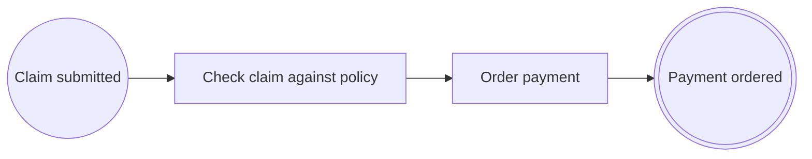

# Lección 2. Tareas, flujos y reglas de negocio

> 🇬🇧 [English version](../../en/course/02-tasks-and-rules.md)

**Objetivo:** convertir la comprobación en una tarea de reglas de negocio ligada a su código, añadir la orden de pago
y ordenar los ids del proceso.

## Lo que vas a aprender

- Los tres tipos de tarea (`@ServiceTask`, `@UserTask`, `@BusinessRuleTask`) y cuándo usar cada uno.
- Qué atributos tiene un `@SequenceFlow` y qué reglas cumple el flujo de salida de una tarea.
- Cómo marcar el código de una regla de negocio con `@BusinessRule` y referenciarla desde un nodo.
- Por qué conviene declarar los ids como constantes.

## Punto de partida

El proyecto de la [lección 1](01-primer-proceso.md): `ExpensesApplication`, `ExpenseClaim`, `DiagramController` y
`ExpenseClaimProcess` con tres nodos (`EXP-SUBMITTED` → `EXP-CHECK` → `EXP-PAYMENT-ORDERED`).

## Pasos

### 1. Los tres tipos de tarea

Las tres anotaciones de tarea tienen los mismos atributos y se comportan igual en ejecución. La diferencia es lo que
cuentan en el diagrama, que es lo que leerá negocio:

| Anotación | Úsala cuando… | En el curso |
|---|---|---|
| `@ServiceTask` | el sistema hace el trabajo solo | `EXP-PAY`: ordenar el pago |
| `@UserTask` | una persona tiene que hacer algo (aprobar, revisar…) | `EXP-APPROVE`, en la lección 3 |
| `@BusinessRuleTask` | el paso aplica reglas de negocio | `EXP-CHECK`: aplicar la política de gastos |

Todas exigen **exactamente un** flujo de salida, sin condición. Para elegir entre varios caminos hace falta un
gateway (lección 3).

Hay una cuarta tarea, `@SendTask`, que además publica un mensaje para otro proceso; solo tiene sentido cuando hay
mensajes entre procesos, así que la verás en la lección 7.

### 2. Declara los ids como constantes

Los vas a repetir: en las anotaciones (`id`, `targetRef`) y, desde la lección 5, en las llamadas al journal. Una
constante `static final String` es una expresión constante, así que vale dentro de una anotación, y un error de
escritura deja de compilar en lugar de fallar en ejecución.

```java
public static final String PROCESS_ID = "EXP-CLAIM";
public static final String SUBMITTED = "EXP-SUBMITTED";
public static final String CHECK = "EXP-CHECK";
public static final String PAY = "EXP-PAY";
public static final String PAYMENT_ORDERED = "EXP-PAYMENT-ORDERED";
```

Son `public` porque otras clases del curso (la versión 2 del proceso, los tests) las usarán.

### 3. Marca el código de la regla

Una **regla de negocio** es una decisión que negocio quiere poder señalar y auditar: «una solicitud necesita
justificantes y un importe positivo». `@BusinessRule` no ejecuta nada: identifica el código que la implementa, con un
id estable (`R-EXP-001`) y un nombre legible. Así el diagrama, la trazabilidad y el historial pueden decir qué regla
se aplicó y dónde está su código.

`src/main/java/com/example/expenses/claim/ExpensePolicyRule.java`:

```java
package com.example.expenses.claim;

import java.math.BigDecimal;

import io.github.eldiegos.bpmncode.annotation.BusinessRule;

public final class ExpensePolicyRule {

	public static final String ID = "R-EXP-001";

	private ExpensePolicyRule() {
	}

	@BusinessRule(id = ID, name = "Claim with receipts and a positive amount",
			documentation = "A claim needs its receipts and an amount greater than zero.")
	public static boolean complies(ExpenseClaim claim) {
		return claim.receiptsAttached() && claim.amount().compareTo(BigDecimal.ZERO) > 0;
	}
}
```

`@BusinessRule` puede ir en un método o en una clase. Su `version` vale 1 por defecto; en la
[lección 9](09-versiones.md) crearás la versión 2 de otra regla.

### 4. Reescribe el proceso

Cambios respecto a la lección 1:

- `EXP-CHECK` pasa a ser `@BusinessRuleTask` y referencia la regla con `businessRuleRefs`. Una tarea de reglas sin
  reglas no compila.
- Nueva tarea `EXP-PAY` («Order payment») entre la comprobación y el fin.
- Los ids salen de las constantes.

`src/main/java/com/example/expenses/claim/ExpenseClaimProcess.java`:

```java
package com.example.expenses.claim;

import org.springframework.stereotype.Service;

import io.github.eldiegos.bpmncode.annotation.BusinessRuleTask;
import io.github.eldiegos.bpmncode.annotation.EndEvent;
import io.github.eldiegos.bpmncode.annotation.Process;
import io.github.eldiegos.bpmncode.annotation.SequenceFlow;
import io.github.eldiegos.bpmncode.annotation.ServiceTask;
import io.github.eldiegos.bpmncode.annotation.StartEvent;

@Service
@Process(id = ExpenseClaimProcess.PROCESS_ID, name = "Expense claim", version = 1,
		documentation = "An employee claims an expense; large amounts need the approval of a manager before payment.")
public class ExpenseClaimProcess {

	public static final String PROCESS_ID = "EXP-CLAIM";
	public static final String SUBMITTED = "EXP-SUBMITTED";
	public static final String CHECK = "EXP-CHECK";
	public static final String PAY = "EXP-PAY";
	public static final String PAYMENT_ORDERED = "EXP-PAYMENT-ORDERED";

	@StartEvent(id = SUBMITTED, name = "Claim submitted", outgoing = @SequenceFlow(targetRef = CHECK))
	public void submit(ExpenseClaim claim) {
		check(claim);
		pay(claim);
	}

	@BusinessRuleTask(id = CHECK, name = "Check claim against policy", businessRuleRefs = ExpensePolicyRule.ID,
			outgoing = @SequenceFlow(targetRef = PAY))
	boolean check(ExpenseClaim claim) {
		return ExpensePolicyRule.complies(claim);
	}

	@ServiceTask(id = PAY, name = "Order payment", outgoing = @SequenceFlow(targetRef = PAYMENT_ORDERED))
	void pay(ExpenseClaim claim) {
		paymentOrdered(claim);
	}

	@EndEvent(id = PAYMENT_ORDERED, name = "Payment ordered")
	void paymentOrdered(ExpenseClaim claim) {
	}
}
```

De momento el resultado de `check` no decide nada: todas las solicitudes se pagan. Lo arreglarás en la lección 3.

### 5. Los atributos de `@SequenceFlow`

Hasta ahora solo has usado `targetRef`. Estos son todos:

| Atributo | Para qué |
|---|---|
| `targetRef` | id del nodo destino (obligatorio) |
| `id` | id del flujo; por defecto `Flow_<origen>_<destino>`, p. ej. `Flow_EXP-CHECK_EXP-PAY` |
| `name` | etiqueta del flujo en el diagrama |
| `when` | solo en gateways: la constante del `enum` que elige esta rama |
| `conditionExpression` | solo en gateways: la condición en texto legible |

`when` y `conditionExpression` en una tarea no compilan: una tarea no decide, solo sigue.

## Comprueba que funciona

Arranca (`./mvnw spring-boot:run`). El log cuenta ahora cuatro nodos y tres flujos:

```
Process definition EXP-CLAIM v1 'Expense claim': 4 flow nodes, 3 sequence flows
```

Pide el diagrama (`curl -s localhost:8080/bpmn/EXP-CLAIM`). La comprobación es ahora una `businessRuleTask` y lleva
la regla como extensión, con su nombre y su versión:

```xml
<bpmn:businessRuleTask id="EXP-CHECK" name="Check claim against policy">
  <bpmn:extensionElements>
    <pac:implementation class="com.example.expenses.claim.ExpenseClaimProcess" method="check(ExpenseClaim)"/>
    <pac:businessRuleRef id="R-EXP-001" name="Claim with receipts and a positive amount" version="1"/>
  </bpmn:extensionElements>
  …
</bpmn:businessRuleTask>
```



## Errores frecuentes

Todos estos los detecta `javac` gracias al procesador, en la línea de la anotación:

- **Dos flujos de salida en una tarea** (`outgoing = { @SequenceFlow(…), @SequenceFlow(…) }`):

  ```
  declares exactly one outgoing sequence flow; use an exclusive gateway to branch
  ```

- **`@BusinessRuleTask` sin reglas** (`businessRuleRefs = {}`):

  ```
  a business rule task must reference at least one business rule
  ```

- **`when` o `conditionExpression` en el flujo de una tarea**:

  ```
  'when' and 'conditionExpression' are only allowed on the outgoing sequence flows of an exclusive gateway
  ```

- **Una regla que no existe** (`businessRuleRefs = "R-EXP-01"`). Esto ya no es local a la anotación, así que compila;
  falla al arrancar con `UNKNOWN_BUSINESS_RULE_REF` (lección 4).

## Ejercicio

Un proceso grande no tiene por qué caber en una clase. Mueve la tarea `EXP-PAY` a una clase propia,
`ClaimPayment`, sin cambiar el modelo.

<details><summary>Solución</summary>

`@ProcessPart(processRef = …)` dice a qué proceso aporta nodos una clase. Los `targetRef` pueden apuntar a nodos de
otra clase del mismo proceso.

```java
package com.example.expenses.claim;

import org.springframework.stereotype.Component;

import io.github.eldiegos.bpmncode.annotation.ProcessPart;
import io.github.eldiegos.bpmncode.annotation.SequenceFlow;
import io.github.eldiegos.bpmncode.annotation.ServiceTask;

@Component
@ProcessPart(processRef = ExpenseClaimProcess.PROCESS_ID)
class ClaimPayment {

	@ServiceTask(id = ExpenseClaimProcess.PAY, name = "Order payment",
			outgoing = @SequenceFlow(targetRef = ExpenseClaimProcess.PAYMENT_ORDERED))
	void pay(ExpenseClaim claim) {
	}
}
```

En `ExpenseClaimProcess` borra el método `pay`, inyecta `ClaimPayment` por constructor y llama a `payment.pay(claim)`
seguido de `paymentOrdered(claim)` desde `submit`. El log sigue diciendo `4 flow nodes, 3 sequence flows`.

`version` se puede omitir en `@ProcessPart` solo mientras el proceso tenga una única versión. El resto del curso
sigue con todo en `ExpenseClaimProcess`: deshaz el cambio antes de pasar a la lección 3.

</details>

## Para saber más

- [Tareas: `@ServiceTask`, `@UserTask`, `@BusinessRuleTask`](../anotaciones.md#tareas-servicetask-usertask-businessruletask)
- [`@SequenceFlow`](../anotaciones.md#sequenceflow) y [`@ProcessPart`](../anotaciones.md#processpart)
- [`@BusinessRule`](../anotaciones.md#businessrule)

---

[← Anterior: Tu primer proceso](01-primer-proceso.md) | [Índice](README.md) | [Siguiente: Decisiones con gateways →](03-decisiones-con-gateways.md)
