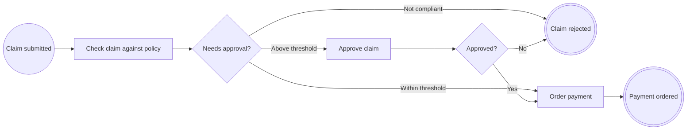

# Lección 3. Decisiones con gateways

> 🇬🇧 [English version](../../en/course/03-decisions-with-gateways.md)

**Objetivo:** que el proceso decida: rechazar lo que no cumple la política, pagar directamente lo pequeño y pedir la
aprobación de un responsable para lo grande.

## Lo que vas a aprender

- Cómo se modela una decisión con `@ExclusiveGateway` y por qué su método devuelve un `enum`.
- Cómo ligar cada rama a una constante con `when` y describirla con `name` y `conditionExpression`.
- Cómo añadir una tarea humana (`@UserTask`) y un segundo evento de fin.
- Que varios flujos pueden llegar al mismo nodo.

## Punto de partida

El código de la [lección 2](02-tareas-y-reglas.md): `ExpenseClaimProcess` con `EXP-SUBMITTED` → `EXP-CHECK`
(regla `R-EXP-001`) → `EXP-PAY` → `EXP-PAYMENT-ORDERED`, y la clase `ExpensePolicyRule`.

## Pasos

### 1. Por qué un `enum`

Un **gateway exclusivo** es un punto en el que el proceso sigue por **una sola** de varias ramas. En `bpmncode` es un
método que devuelve un `enum`, y cada constante es una rama: el atributo `when` de cada `@SequenceFlow` nombra la
constante que la elige.

Así la rama queda ligada al código y no a un texto: el compilador te obliga a tratar todas las constantes en un
`switch`, y el procesador comprueba que las constantes y los `when` coinciden **exactamente**, ni una más ni una menos.

Vas a necesitar dos decisiones:

```java
public enum Route { NON_COMPLIANT, NEEDS_APPROVAL, AUTO_APPROVED }

public enum Decision { APPROVED, REJECTED }
```

### 2. La regla del umbral

La decisión «¿necesita aprobación?» depende de una regla de negocio nueva, `R-EXP-002`: más de 1.000 EUR necesita la
aprobación de un responsable.

`src/main/java/com/example/expenses/claim/ApprovalThresholdRule.java`:

```java
package com.example.expenses.claim;

import java.math.BigDecimal;

import io.github.eldiegos.bpmncode.annotation.BusinessRule;

public final class ApprovalThresholdRule {

	public static final String ID = "R-EXP-002";

	private static final BigDecimal THRESHOLD = new BigDecimal("1000");

	private ApprovalThresholdRule() {
	}

	@BusinessRule(id = ID, name = "Manager approval above 1,000 EUR")
	public static boolean needsApproval(BigDecimal amount) {
		return amount.compareTo(THRESHOLD) > 0;
	}
}
```

Los gateways también aceptan `businessRuleRefs`: el diagrama mostrará qué regla decide la rama.

### 3. El proceso con sus decisiones

Nodos nuevos:

| Id | Anotación | Nombre |
|---|---|---|
| `EXP-ROUTE` | `@ExclusiveGateway` | Needs approval? |
| `EXP-APPROVE` | `@UserTask` | Approve claim |
| `EXP-DECISION` | `@ExclusiveGateway` | Approved? |
| `EXP-REJECTED` | `@EndEvent` | Claim rejected |

`EXP-CHECK` ya no va a `EXP-PAY`, sino a `EXP-ROUTE`. Dos flujos llegan a `EXP-PAY` (desde `EXP-ROUTE` y desde
`EXP-DECISION`) y dos a `EXP-REJECTED`: un nodo puede tener tantos flujos de entrada como haga falta.

`src/main/java/com/example/expenses/claim/ExpenseClaimProcess.java`:

```java
package com.example.expenses.claim;

import org.springframework.stereotype.Service;

import io.github.eldiegos.bpmncode.annotation.BusinessRuleTask;
import io.github.eldiegos.bpmncode.annotation.EndEvent;
import io.github.eldiegos.bpmncode.annotation.ExclusiveGateway;
import io.github.eldiegos.bpmncode.annotation.Process;
import io.github.eldiegos.bpmncode.annotation.SequenceFlow;
import io.github.eldiegos.bpmncode.annotation.ServiceTask;
import io.github.eldiegos.bpmncode.annotation.StartEvent;
import io.github.eldiegos.bpmncode.annotation.UserTask;

@Service
@Process(id = ExpenseClaimProcess.PROCESS_ID, name = "Expense claim", version = 1,
		documentation = "An employee claims an expense; large amounts need the approval of a manager before payment.")
public class ExpenseClaimProcess {

	public static final String PROCESS_ID = "EXP-CLAIM";
	public static final String SUBMITTED = "EXP-SUBMITTED";
	public static final String CHECK = "EXP-CHECK";
	public static final String ROUTE = "EXP-ROUTE";
	public static final String APPROVE = "EXP-APPROVE";
	public static final String DECISION = "EXP-DECISION";
	public static final String PAY = "EXP-PAY";
	public static final String PAYMENT_ORDERED = "EXP-PAYMENT-ORDERED";
	public static final String REJECTED = "EXP-REJECTED";

	public enum Route { NON_COMPLIANT, NEEDS_APPROVAL, AUTO_APPROVED }

	public enum Decision { APPROVED, REJECTED }

	@StartEvent(id = SUBMITTED, name = "Claim submitted", outgoing = @SequenceFlow(targetRef = CHECK))
	public void submit(ExpenseClaim claim) {
		var compliant = check(claim);
		switch (route(claim, compliant)) {
			case NON_COMPLIANT -> reject(claim);
			case AUTO_APPROVED -> pay(claim);
			case NEEDS_APPROVAL -> {
				// Decide un responsable, más tarde: approve(...)
			}
		}
	}

	@BusinessRuleTask(id = CHECK, name = "Check claim against policy", businessRuleRefs = ExpensePolicyRule.ID,
			outgoing = @SequenceFlow(targetRef = ROUTE))
	boolean check(ExpenseClaim claim) {
		return ExpensePolicyRule.complies(claim);
	}

	@ExclusiveGateway(id = ROUTE, name = "Needs approval?", businessRuleRefs = ApprovalThresholdRule.ID,
			outgoing = {
					@SequenceFlow(when = "NON_COMPLIANT", targetRef = REJECTED, name = "Not compliant"),
					@SequenceFlow(when = "NEEDS_APPROVAL", targetRef = APPROVE, name = "Above threshold",
							conditionExpression = "Amount > 1,000 EUR"),
					@SequenceFlow(when = "AUTO_APPROVED", targetRef = PAY, name = "Within threshold") })
	Route route(ExpenseClaim claim, boolean compliant) {
		if (!compliant) {
			return Route.NON_COMPLIANT;
		}
		return ApprovalThresholdRule.needsApproval(claim.amount()) ? Route.NEEDS_APPROVAL : Route.AUTO_APPROVED;
	}

	@UserTask(id = APPROVE, name = "Approve claim", outgoing = @SequenceFlow(targetRef = DECISION))
	public void approve(ExpenseClaim claim, Decision decision) {
		switch (decide(decision)) {
			case APPROVED -> pay(claim);
			case REJECTED -> reject(claim);
		}
	}

	@ExclusiveGateway(id = DECISION, name = "Approved?",
			outgoing = {
					@SequenceFlow(when = "APPROVED", targetRef = PAY, name = "Yes"),
					@SequenceFlow(when = "REJECTED", targetRef = REJECTED, name = "No") })
	Decision decide(Decision decision) {
		return decision;
	}

	@ServiceTask(id = PAY, name = "Order payment", outgoing = @SequenceFlow(targetRef = PAYMENT_ORDERED))
	void pay(ExpenseClaim claim) {
		paymentOrdered(claim);
	}

	@EndEvent(id = PAYMENT_ORDERED, name = "Payment ordered")
	void paymentOrdered(ExpenseClaim claim) {
	}

	@EndEvent(id = REJECTED, name = "Claim rejected")
	void reject(ExpenseClaim claim) {
	}
}
```

Puntos clave:

- **`name`** etiqueta la rama en el diagrama («Yes», «No»). **`conditionExpression`** es la condición en texto
  legible; si la omites, se exporta el valor de `when`.
- **`approve` es `public`**: lo llamará la interfaz cuando el responsable decida. `submit` no lo llama, porque la
  aprobación llega más tarde. En la lección 6 verás cómo se retoma el proceso en ese momento.
- El gateway `EXP-DECISION` parece trivial (devuelve lo que recibe), pero hace visible en el diagrama que la decisión
  del responsable abre dos caminos.

**Otros eventos de fin.** Como los de inicio, hay una anotación por tipo de evento de fin: `@EndEvent` (fin simple),
`@MessageEndEvent` (termina publicando un mensaje; lo usarás en la lección 7) y `@ErrorEndEvent` (termina con un error
de negocio). Aquí el rechazo es un desenlace más de la solicitud y basta un `@EndEvent`. Si otros sistemas tuvieran que
reconocer el rechazo por un código estable, `EXP-REJECTED` podría ser un evento de fin de error: el error es una
excepción anotada con `@ProcessError`, y el evento la referencia en `errorRef`. Solo como referencia, no lo añadas al
proyecto:

```java
@ProcessError(id = "ERR-EXP-REJECTED", name = "Claim rejected", errorCode = "CLAIM_REJECTED")
public class ClaimRejected extends RuntimeException {
	public ClaimRejected(String reason) {
		super(reason);
	}
}

@ErrorEndEvent(id = REJECTED, name = "Claim rejected", errorRef = ClaimRejected.class)
void reject(ExpenseClaim claim) {
}
```

En el BPMN sería un `bpmn:endEvent` con `bpmn:errorEventDefinition` y el error, un `bpmn:error` con su `errorCode`. La
instancia sigue terminando ahí, completada: el error es su resultado de negocio, no un fallo técnico.

## Comprueba que funciona

Arranca la aplicación:

```
Process definition EXP-CLAIM v1 'Expense claim': 8 flow nodes, 9 sequence flows
```

Descarga el diagrama y ábrelo en [demo.bpmn.io](https://demo.bpmn.io):



En el XML, cada rama lleva su constante en `pac:when` y su condición en `bpmn:conditionExpression`, y la tarea humana
es una `bpmn:userTask`.

Si quieres comprobarlo sin arrancar, añade esta prueba. `AnnotationProcessModelReader.scan` lee y valida el modelo de
un paquete sin Spring (es una clase del paquete interno `model.reader`; úsala en pruebas):

`src/test/java/com/example/expenses/ProcessModelTests.java`:

```java
package com.example.expenses;

import static org.assertj.core.api.Assertions.assertThat;

import org.junit.jupiter.api.Test;

import io.github.eldiegos.bpmncode.model.reader.AnnotationProcessModelReader;

class ProcessModelTests {

	@Test
	void theProcessModelIsValid() {
		var definitions = AnnotationProcessModelReader.scan("com.example.expenses");
		var process = definitions.process("EXP-CLAIM").orElseThrow();
		assertThat(process.flowNodes()).hasSize(8);
		assertThat(process.sequenceFlows()).hasSize(9);
	}
}
```

```bash
./mvnw test
```

## Errores frecuentes

- **Falta una rama para una constante** (quitas el flujo `AUTO_APPROVED`):

  ```
  constants of Route without an outgoing sequence flow: [AUTO_APPROVED]
  ```

- **Un `when` que no es una constante** (`when = "MAYBE"` en `EXP-DECISION`):

  ```
  'MAYBE' is not a constant of Decision [APPROVED, REJECTED]
  ```

- **El método del gateway no devuelve un `enum`** (devuelve `String` o `boolean`):

  ```
  an exclusive gateway method must return an enum whose constants select the outgoing sequence flows; it returns java.lang.String
  ```

- **Dos ramas del mismo gateway van al mismo nodo.** Compila, pero ambos flujos tendrían el id por defecto
  `Flow_EXP-ROUTE_EXP-APPROVE` y la aplicación no arranca:

  ```
  [DUPLICATE_ID] com.example.expenses.claim.ExpenseClaimProcess#route(ExpenseClaim, boolean): identifier Flow_EXP-ROUTE_EXP-APPROVE is already declared at …
  ```

  Dale a una de ellas un `id` propio en su `@SequenceFlow`.

## Ejercicio

Negocio quiere que una solicitud rechazada por el responsable no termine en el mismo evento de fin que una que no
cumple la política. Añade un evento de fin `EXP-REJECTED-BY-MANAGER` («Claim rejected by manager») para la rama
`REJECTED` de `EXP-DECISION`. ¿Cuántos nodos y flujos tendrá el proceso?

<details><summary>Solución</summary>

```java
public static final String REJECTED_BY_MANAGER = "EXP-REJECTED-BY-MANAGER";

@ExclusiveGateway(id = DECISION, name = "Approved?",
		outgoing = {
				@SequenceFlow(when = "APPROVED", targetRef = PAY, name = "Yes"),
				@SequenceFlow(when = "REJECTED", targetRef = REJECTED_BY_MANAGER, name = "No") })
Decision decide(Decision decision) {
	return decision;
}

@EndEvent(id = REJECTED_BY_MANAGER, name = "Claim rejected by manager")
void rejectedByManager(ExpenseClaim claim) {
}
```

En `approve`, la rama `REJECTED` llama a `rejectedByManager(claim)`. El proceso pasa a 9 nodos y sigue con 9 flujos
(el de `EXP-DECISION` cambia de destino). El resto del curso sigue con un único `EXP-REJECTED`: deshaz el cambio antes
de continuar.

</details>

## Para saber más

- [`@ExclusiveGateway`](../anotaciones.md#exclusivegateway)
- [Eventos de fin](../anotaciones.md#eventos-de-fin): `@EndEvent`, `@MessageEndEvent`, `@ErrorEndEvent` y
  `@ProcessError`
- [Validación: probar el modelo](../validacion.md#probar-el-modelo)

---

[← Anterior: Tareas, flujos y reglas de negocio](02-tareas-y-reglas.md) | [Índice](README.md) | [Siguiente: Validación al compilar y al arrancar →](04-validacion.md)
