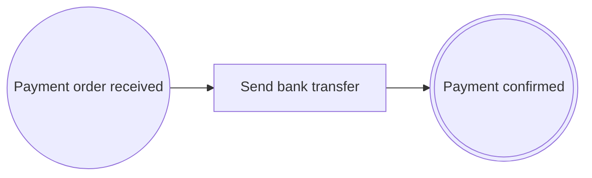

# Lección 7. Mensajes entre procesos

> 🇬🇧 [English version](../../en/course/07-messages-between-processes.md)

**Objetivo:** que la solicitud aprobada inicie el proceso de pago de Tesorería con un mensaje, y que el pago termine
publicando la confirmación cuando el banco confirma la transferencia.

## Lo que vas a aprender

- Cómo se comunican dos procesos: un evento de fin que publica un mensaje y un evento de inicio que lo recibe.
- Cómo se declara un mensaje como contrato versionado (`@Message`, `@MessageVersion`, `MessageHeader`).
- Cómo publicarlo y recibirlo con los eventos de Spring, y cómo hacer idempotente la recepción.
- Cuándo publicar con una tarea de envío (`@SendTask`) en lugar de con un evento de fin.
- Cómo se congela el contrato en `pac/message-contracts.lock` y qué pasa si lo cambias.

## Punto de partida

El código de la [lección 6](06-tareas-que-esperan.md): `ExpenseClaimProcess` termina en `EXP-PAYMENT-ORDERED` con un
resultado normal, las solicitudes se guardan en `ExpenseClaims` y `ClaimController` expone el envío y la aprobación.

## Pasos

### 1. Por qué un segundo proceso

Pagar no es cosa del proceso de solicitudes: lo hace Tesorería, con sus propias reglas y a su ritmo. Por eso el pago
será otro proceso, `EXP-PAYMENT`, que empieza cuando le llega una orden de pago.

En `bpmncode` los procesos solo se comunican por **mensajes**: uno publica el mensaje, al terminar en un
`@MessageEndEvent(messageRef = …)` o a mitad del proceso en una `@SendTask(messageRef = …)`, y el otro empieza en un
`@MessageStartEvent` que lo recibe. La librería **no transporta** los mensajes: se publican con el
`ApplicationEventPublisher` de Spring y se reciben con un listener. Lo que aporta es el contrato, la comprobación de
los dos extremos y la evidencia.

El nuevo proceso:



Tras enviar la transferencia, la instancia espera en `PAY-TRANSFER` hasta que el banco confirma. La confirmación del
banco no es un proceso de tu aplicación, así que no puede ser un mensaje de `bpmncode` (todo evento de inicio de
mensaje necesita un proceso que lo publique). Llega por un *webhook* HTTP que completa el proceso, y es entonces
cuando `EXP-PAYMENT` publica su propio mensaje, la confirmación de pago.

### 2. Declara los mensajes

Un mensaje es un contrato entre dos procesos que evolucionan por separado, así que se versiona desde el principio:

- `@Message` va en una `sealed interface` (la **familia**) que extiende `ProcessMessage`.
- Cada versión es un `record` con `@MessageVersion(n)` que implementa la familia. Su primer componente es la cabecera
  `MessageHeader header`, común a todos los mensajes.

`src/main/java/com/example/expenses/claim/PaymentOrdered.java`:

```java
package com.example.expenses.claim;

import java.util.UUID;

import io.github.eldiegos.bpmncode.annotation.Message;
import io.github.eldiegos.bpmncode.runtime.ProcessMessage;

@Message(id = "EV-EXP-PAYMENT-ORDERED", name = "Expense payment ordered")
public sealed interface PaymentOrdered extends ProcessMessage permits PaymentOrderedV1 {

	UUID claimId();
}
```

`src/main/java/com/example/expenses/claim/PaymentOrderedV1.java`:

```java
package com.example.expenses.claim;

import java.math.BigDecimal;
import java.util.UUID;

import io.github.eldiegos.bpmncode.annotation.MessageVersion;
import io.github.eldiegos.bpmncode.runtime.MessageHeader;

@MessageVersion(1)
public record PaymentOrderedV1(MessageHeader header, UUID claimId, BigDecimal amount) implements PaymentOrdered {
}
```

Si un mensaje va a tener una sola versión, `@Message` puede ir directamente en el record. Es el caso de la
confirmación:

`src/main/java/com/example/expenses/claim/PaymentConfirmed.java`:

```java
package com.example.expenses.claim;

import java.util.UUID;

import io.github.eldiegos.bpmncode.annotation.Message;
import io.github.eldiegos.bpmncode.runtime.MessageHeader;
import io.github.eldiegos.bpmncode.runtime.ProcessMessage;

@Message(id = "EV-EXP-PAYMENT-CONFIRMED", name = "Expense payment confirmed")
public record PaymentConfirmed(MessageHeader header, UUID claimId, String bankReference) implements ProcessMessage {
}
```

Los dos mensajes viven en el paquete `claim`: el módulo de solicitudes define los contratos y Tesorería depende de
él, nunca al revés. En la lección 12 Spring Modulith lo comprobará.

### 3. Publica al terminar la solicitud

`EXP-PAYMENT-ORDERED` pasa a ser un **evento de fin de mensaje**. Igual que el inicio por mensaje tiene su propia
anotación (`@MessageStartEvent`), el fin que publica un mensaje también: `@MessageEndEvent`, que sustituye a su
`@EndEvent` y declara qué versión publica (`messageRef = PaymentOrderedV1.class`, nunca la familia). `@EndEvent` sigue
siendo el fin simple, sin `messageRef`, como `EXP-REJECTED`.

Para publicar la orden de pago:

1. `journal.messageHeader(instance)` prepara la cabecera: id del envío, correlación de la instancia, momento y origen.
   No la construyas a mano.
2. `journal.reachEndEvent(instance, id, message)` comprueba que el mensaje es la versión declarada y que su cabecera
   es de esta instancia, completa la instancia y registra `MESSAGE_PUBLISHED`.
3. `events.publishEvent(message)` lo entrega a los listeners.

Registra **antes** de publicar: si la conformidad rechaza el paso, el mensaje no llega a salir.

`src/main/java/com/example/expenses/claim/ExpenseClaimProcess.java` completo:

```java
package com.example.expenses.claim;

import java.util.UUID;

import org.springframework.context.ApplicationEventPublisher;
import org.springframework.stereotype.Service;

import io.github.eldiegos.bpmncode.annotation.BusinessRuleTask;
import io.github.eldiegos.bpmncode.annotation.EndEvent;
import io.github.eldiegos.bpmncode.annotation.ExclusiveGateway;
import io.github.eldiegos.bpmncode.annotation.MessageEndEvent;
import io.github.eldiegos.bpmncode.annotation.Process;
import io.github.eldiegos.bpmncode.annotation.SequenceFlow;
import io.github.eldiegos.bpmncode.annotation.ServiceTask;
import io.github.eldiegos.bpmncode.annotation.StartEvent;
import io.github.eldiegos.bpmncode.annotation.UserTask;
import io.github.eldiegos.bpmncode.model.ProcessDefinitionRef;
import io.github.eldiegos.bpmncode.runtime.CorrelationKey;
import io.github.eldiegos.bpmncode.runtime.FlowNodeOutcome;
import io.github.eldiegos.bpmncode.runtime.ProcessInstanceRef;
import io.github.eldiegos.bpmncode.runtime.ProcessJournal;

@Service
@Process(id = ExpenseClaimProcess.PROCESS_ID, name = "Expense claim", version = 1,
		documentation = "An employee claims an expense; large amounts need the approval of a manager before payment.")
public class ExpenseClaimProcess {

	public static final String PROCESS_ID = "EXP-CLAIM";
	public static final String SUBMITTED = "EXP-SUBMITTED";
	public static final String CHECK = "EXP-CHECK";
	public static final String ROUTE = "EXP-ROUTE";
	public static final String APPROVE = "EXP-APPROVE";
	public static final String DECISION = "EXP-DECISION";
	public static final String PAY = "EXP-PAY";
	public static final String PAYMENT_ORDERED = "EXP-PAYMENT-ORDERED";
	public static final String REJECTED = "EXP-REJECTED";

	static final ProcessDefinitionRef KEY = ProcessDefinitionRef.of(PROCESS_ID, 1);

	public enum Route { NON_COMPLIANT, NEEDS_APPROVAL, AUTO_APPROVED }

	public enum Decision { APPROVED, REJECTED }

	private final ProcessJournal journal;
	private final ExpenseClaims claims;
	private final ApplicationEventPublisher events;

	ExpenseClaimProcess(ProcessJournal journal, ExpenseClaims claims, ApplicationEventPublisher events) {
		this.journal = journal;
		this.claims = claims;
		this.events = events;
	}

	@StartEvent(id = SUBMITTED, name = "Claim submitted", outgoing = @SequenceFlow(targetRef = CHECK))
	public ProcessInstanceRef submit(ExpenseClaim claim) {
		claims.save(claim);
		var instance = journal.startProcessInstance(KEY, CorrelationKey.of(claim.id()), FlowNodeOutcome.of("SUBMITTED"));
		journal.setBusinessKey(instance, "claim:" + claim.id());
		var compliant = check(instance, claim);
		switch (route(instance, claim, compliant)) {
			case NON_COMPLIANT -> reject(instance, "NON_COMPLIANT");
			case AUTO_APPROVED -> pay(instance, claim);
			case NEEDS_APPROVAL -> {
				// La instancia espera en EXP-APPROVE hasta que el responsable decida.
			}
		}
		return instance;
	}

	@BusinessRuleTask(id = CHECK, name = "Check claim against policy", businessRuleRefs = ExpensePolicyRule.ID,
			outgoing = @SequenceFlow(targetRef = ROUTE))
	boolean check(ProcessInstanceRef instance, ExpenseClaim claim) {
		var compliant = ExpensePolicyRule.complies(claim);
		journal.completeActivity(instance, CHECK, compliant ? FlowNodeOutcome.of("COMPLIANT")
				: FlowNodeOutcome.of("RULES_VIOLATED", "R-EXP-001@1"));
		return compliant;
	}

	@ExclusiveGateway(id = ROUTE, name = "Needs approval?", businessRuleRefs = ApprovalThresholdRule.ID,
			outgoing = {
					@SequenceFlow(when = "NON_COMPLIANT", targetRef = REJECTED, name = "Not compliant"),
					@SequenceFlow(when = "NEEDS_APPROVAL", targetRef = APPROVE, name = "Above threshold",
							conditionExpression = "Amount > 1,000 EUR"),
					@SequenceFlow(when = "AUTO_APPROVED", targetRef = PAY, name = "Within threshold") })
	Route route(ProcessInstanceRef instance, ExpenseClaim claim, boolean compliant) {
		Route route;
		if (!compliant) {
			route = Route.NON_COMPLIANT;
		}
		else if (ApprovalThresholdRule.needsApproval(claim.amount())) {
			route = Route.NEEDS_APPROVAL;
		}
		else {
			route = Route.AUTO_APPROVED;
		}
		return journal.selectSequenceFlow(instance, ROUTE, route);
	}

	@UserTask(id = APPROVE, name = "Approve claim", outgoing = @SequenceFlow(targetRef = DECISION))
	public void approve(UUID claimId, Decision decision) {
		var claim = claims.find(claimId).orElseThrow();
		var instance = journal.require(PROCESS_ID, CorrelationKey.of(claimId));
		journal.completeActivity(instance, APPROVE, FlowNodeOutcome.of("DECIDED", decision.name()));
		switch (decide(instance, decision)) {
			case APPROVED -> pay(instance, claim);
			case REJECTED -> reject(instance, "REJECTED_BY_MANAGER");
		}
	}

	@ExclusiveGateway(id = DECISION, name = "Approved?",
			outgoing = {
					@SequenceFlow(when = "APPROVED", targetRef = PAY, name = "Yes"),
					@SequenceFlow(when = "REJECTED", targetRef = REJECTED, name = "No") })
	Decision decide(ProcessInstanceRef instance, Decision decision) {
		return journal.selectSequenceFlow(instance, DECISION, decision);
	}

	@ServiceTask(id = PAY, name = "Order payment", outgoing = @SequenceFlow(targetRef = PAYMENT_ORDERED))
	void pay(ProcessInstanceRef instance, ExpenseClaim claim) {
		journal.completeActivity(instance, PAY, FlowNodeOutcome.of("PAYMENT_ORDERED"));
		paymentOrdered(instance, claim);
	}

	@MessageEndEvent(id = PAYMENT_ORDERED, name = "Payment ordered", messageRef = PaymentOrderedV1.class)
	void paymentOrdered(ProcessInstanceRef instance, ExpenseClaim claim) {
		var message = new PaymentOrderedV1(journal.messageHeader(instance), claim.id(), claim.amount());
		journal.reachEndEvent(instance, PAYMENT_ORDERED, message);
		events.publishEvent(message);
	}

	@EndEvent(id = REJECTED, name = "Claim rejected")
	void reject(ProcessInstanceRef instance, String reason) {
		journal.reachEndEvent(instance, REJECTED, FlowNodeOutcome.of(reason));
	}
}
```

Respecto a la lección 6 cambian el constructor (recibe `ApplicationEventPublisher`), `paymentOrdered` (ahora con
`@MessageEndEvent`) y los imports (`MessageEndEvent`).

**Publicar sin terminar: la tarea de envío.** La solicitud no tiene nada más que hacer después de ordenar el pago, así
que publica la orden al terminar. Si tuviera que seguir (por ejemplo, para esperar ella misma la confirmación),
`EXP-PAY` sería una tarea de envío (`@SendTask`): publica el mensaje y la instancia continúa sin esperar respuesta.
Solo como referencia, no lo añadas al proyecto:

```java
@SendTask(id = PAY, name = "Order payment", messageRef = PaymentOrderedV1.class,
		outgoing = @SequenceFlow(targetRef = …))
void pay(ProcessInstanceRef instance, ExpenseClaim claim) {
	var message = new PaymentOrderedV1(journal.messageHeader(instance), claim.id(), claim.amount());
	journal.completeActivity(instance, PAY, message);   // MESSAGE_PUBLISHED EV-EXP-PAYMENT-ORDERED@1 <messageId>
	events.publishEvent(message);
	// la instancia sigue hacia el nodo siguiente
}
```

Se completa con `completeActivity(instance, id, message)`, que comprueba la versión y la cabecera igual que
`reachEndEvent`; con un `FlowNodeOutcome` la conformidad la rechaza (`EXP-PAY sends EV-EXP-PAYMENT-ORDERED@1: complete
it with completeActivity(instance, sendTaskId, message)`). El flujo de mensaje del diagrama saldría de la tarea, no del
evento de fin.

### 4. El proceso de pago

El método del `@MessageStartEvent` tiene que ser un listener de Spring (`@EventListener`, o una anotación que lo
lleve) cuyo parámetro sea el mensaje. `messageRef = PaymentOrdered.class` (la familia) acepta todas sus versiones.

Dos detalles importantes:

- **La correlación viaja en la cabecera.** La instancia de pago hereda la del mensaje, es decir, el id de la solicitud.
  Por eso más tarde `journal.require("EXP-PAYMENT", CorrelationKey.of(claimId))` la encuentra.
- **Las entregas pueden repetirse.** Con una entrega «al menos una vez», el mismo mensaje puede llegar dos veces.
  `startProcessInstanceIfAbsent` no inicia una segunda instancia: devuelve `ProcessStart.Started` con la nueva o
  `ProcessStart.AlreadyStarted` con la existente.

Las versiones se tratan con un `switch` **sin `default`**: si algún día añades `PaymentOrderedV2` a la familia sellada,
este código dejará de compilar hasta que decidas qué hacer con ella.

`src/main/java/com/example/expenses/payment/ExpensePaymentProcess.java`:

```java
package com.example.expenses.payment;

import java.util.UUID;

import org.slf4j.Logger;
import org.slf4j.LoggerFactory;
import org.springframework.context.ApplicationEventPublisher;
import org.springframework.context.event.EventListener;
import org.springframework.stereotype.Service;

import com.example.expenses.claim.PaymentConfirmed;
import com.example.expenses.claim.PaymentOrdered;
import com.example.expenses.claim.PaymentOrderedV1;

import io.github.eldiegos.bpmncode.annotation.MessageEndEvent;
import io.github.eldiegos.bpmncode.annotation.MessageStartEvent;
import io.github.eldiegos.bpmncode.annotation.Process;
import io.github.eldiegos.bpmncode.annotation.SequenceFlow;
import io.github.eldiegos.bpmncode.annotation.ServiceTask;
import io.github.eldiegos.bpmncode.model.ProcessDefinitionRef;
import io.github.eldiegos.bpmncode.runtime.CorrelationKey;
import io.github.eldiegos.bpmncode.runtime.FlowNodeOutcome;
import io.github.eldiegos.bpmncode.runtime.ProcessInstanceRef;
import io.github.eldiegos.bpmncode.runtime.ProcessJournal;
import io.github.eldiegos.bpmncode.runtime.ProcessStart;

@Service
@Process(id = ExpensePaymentProcess.PROCESS_ID, name = "Expense payment", version = 1,
		documentation = "Treasury pays an approved claim and waits for the bank to confirm the transfer.")
public class ExpensePaymentProcess {

	public static final String PROCESS_ID = "EXP-PAYMENT";
	public static final String ORDER_RECEIVED = "PAY-ORDER-RECEIVED";
	public static final String TRANSFER = "PAY-TRANSFER";
	public static final String CONFIRMED = "PAY-CONFIRMED";

	static final ProcessDefinitionRef KEY = ProcessDefinitionRef.of(PROCESS_ID, 1);

	private static final Logger log = LoggerFactory.getLogger(ExpensePaymentProcess.class);

	private final ProcessJournal journal;
	private final ApplicationEventPublisher events;

	ExpensePaymentProcess(ProcessJournal journal, ApplicationEventPublisher events) {
		this.journal = journal;
		this.events = events;
	}

	@EventListener
	@MessageStartEvent(id = ORDER_RECEIVED, name = "Payment order received", messageRef = PaymentOrdered.class,
			outgoing = @SequenceFlow(targetRef = TRANSFER))
	public void on(PaymentOrdered order) {
		switch (journal.startProcessInstanceIfAbsent(KEY, order, FlowNodeOutcome.of("ORDER_RECEIVED"))) {
			case ProcessStart.Started started -> transfer(started.instance(), order);
			case ProcessStart.AlreadyStarted repeated -> log.info("Payment order for claim {} already received",
					order.claimId());
		}
	}

	@ServiceTask(id = TRANSFER, name = "Send bank transfer", outgoing = @SequenceFlow(targetRef = CONFIRMED))
	void transfer(ProcessInstanceRef instance, PaymentOrdered order) {
		var amount = switch (order) {
			case PaymentOrderedV1 v1 -> v1.amount();
		};
		log.info("Bank transfer of {} EUR sent for claim {}", amount, order.claimId());
		journal.completeActivity(instance, TRANSFER, FlowNodeOutcome.of("TRANSFER_SENT"));
	}

	@MessageEndEvent(id = CONFIRMED, name = "Payment confirmed", messageRef = PaymentConfirmed.class)
	public void confirm(UUID claimId, String bankReference) {
		var instance = journal.require(PROCESS_ID, CorrelationKey.of(claimId));
		var confirmation = new PaymentConfirmed(journal.messageHeader(instance), claimId, bankReference);
		journal.reachEndEvent(instance, CONFIRMED, confirmation);
		events.publishEvent(confirmation);
	}
}
```

Si prefieres no tratar la idempotencia, existe `journal.startProcessInstance(KEY, order)`: inicia la instancia y
registra el resultado `MESSAGE_RECEIVED` con la versión recibida, pero una segunda entrega lanzaría
`DuplicateProcessInstanceException`.

### 5. El webhook del banco

`confirm` es un evento de fin que espera, igual que la aprobación: lo llama el banco cuando le parece.

`src/main/java/com/example/expenses/payment/BankWebhookController.java`:

```java
package com.example.expenses.payment;

import java.util.UUID;

import org.springframework.http.HttpStatus;
import org.springframework.web.bind.annotation.PathVariable;
import org.springframework.web.bind.annotation.PostMapping;
import org.springframework.web.bind.annotation.RequestBody;
import org.springframework.web.bind.annotation.ResponseStatus;
import org.springframework.web.bind.annotation.RestController;

@RestController
class BankWebhookController {

	record BankConfirmation(String bankReference) {
	}

	private final ExpensePaymentProcess payments;

	BankWebhookController(ExpensePaymentProcess payments) {
		this.payments = payments;
	}

	@PostMapping("/bank/confirmations/{claimId}")
	@ResponseStatus(HttpStatus.NO_CONTENT)
	void confirmed(@PathVariable UUID claimId, @RequestBody BankConfirmation confirmation) {
		payments.confirm(claimId, confirmation.bankReference());
	}
}
```

### 6. Quien escucha la confirmación

La confirmación no inicia ningún proceso: la escucha un listener normal del módulo de solicitudes, que aquí solo deja
una línea en el log (en una aplicación real avisaría al empleado). Publicar un mensaje que ningún proceso consume está
permitido.

`src/main/java/com/example/expenses/claim/ClaimNotifications.java`:

```java
package com.example.expenses.claim;

import org.slf4j.Logger;
import org.slf4j.LoggerFactory;
import org.springframework.context.event.EventListener;
import org.springframework.stereotype.Component;

@Component
class ClaimNotifications {

	private static final Logger log = LoggerFactory.getLogger(ClaimNotifications.class);

	@EventListener
	void on(PaymentConfirmed confirmation) {
		log.info("Claim {} paid (bank reference {})", confirmation.claimId(), confirmation.bankReference());
	}
}
```

### 7. Congela los contratos

Al arrancar, `bpmncode` genera un JSON Schema de cada versión de mensaje y calcula su huella SHA-256. Si la aplicación
tiene el fichero `pac/message-contracts.lock`, compara cada versión con la huella congelada: así nadie cambia un
contrato publicado sin darse cuenta. Sin fichero no se comprueba nada, así que créalo ya, solo con un comentario:

`src/main/resources/pac/message-contracts.lock`:

```
# Contratos congelados de los mensajes entre procesos.
```

Arranca. La aplicación no arranca, y te dice exactamente qué líneas añadir:

```
Invalid process model (2 problem(s)):
  - [MESSAGE_CONTRACT_NOT_LOCKED] Message com.example.expenses.claim.PaymentConfirmed: EV-EXP-PAYMENT-CONFIRMED@1 is not frozen in pac/message-contracts.lock; add the line: EV-EXP-PAYMENT-CONFIRMED@1 = sha256:a803827cc6ed81506dfa9fa8e0a2c08887fe13c5e0f0b00684eb5a9c93eb3ab7
  - [MESSAGE_CONTRACT_NOT_LOCKED] Message com.example.expenses.claim.PaymentOrderedV1: EV-EXP-PAYMENT-ORDERED@1 is not frozen in pac/message-contracts.lock; add the line: EV-EXP-PAYMENT-ORDERED@1 = sha256:007720056f0bb698316584c3e627fc68e4cbd20d3b29a98fa358f1fed627ec24
```

Cópialas al fichero (si tus records son idénticos a los del curso, las huellas coinciden):

```
# Contratos congelados de los mensajes entre procesos.
EV-EXP-PAYMENT-CONFIRMED@1 = sha256:a803827cc6ed81506dfa9fa8e0a2c08887fe13c5e0f0b00684eb5a9c93eb3ab7
EV-EXP-PAYMENT-ORDERED@1 = sha256:007720056f0bb698316584c3e627fc68e4cbd20d3b29a98fa358f1fed627ec24
```

Este fichero va al control de versiones, como cualquier contrato.

### 8. Ajusta la prueba

El último paso de una solicitud pagada ya no registra tu resultado `COMPLETED`: un evento de fin de mensaje registra
`MESSAGE_PUBLISHED` con la versión publicada. En `aSmallClaimIsPaidStraightAway`, cambia la última aserción:

```java
		assertThat(history.flowNodeInstances(instance.instanceId()))
				.extracting(step -> step.outcome().toString())
				.containsExactly("SUBMITTED", "COMPLIANT", "SEQUENCE_FLOW_SELECTED:AUTO_APPROVED → EXP-PAY",
						"PAYMENT_ORDERED", "MESSAGE_PUBLISHED:EV-EXP-PAYMENT-ORDERED@1");
```

## Comprueba que funciona

`./mvnw test` pasa. Arranca la aplicación. El log muestra los dos procesos:

```
Process definition EXP-CLAIM v1 'Expense claim': 8 flow nodes, 9 sequence flows
Process definition EXP-PAYMENT v1 'Expense payment': 3 flow nodes, 2 sequence flows
```

Envía una solicitud grande, apruébala y confirma la transferencia (sustituye `$CLAIM` por el `claimId` devuelto):

```bash
curl -s -XPOST localhost:8080/claims -H 'Content-Type: application/json' \
     -d '{"employee":"E-1042","amount":1800,"receiptsAttached":true}'
curl -s -XPOST localhost:8080/claims/$CLAIM/approval -H 'Content-Type: application/json' -d '{"decision":"APPROVED"}'
curl -s localhost:8080/claims/$CLAIM/instances
```

La correlación devuelve ahora **dos** instancias: `EXP-CLAIM`, completada con `publishedMessage`
`EV-EXP-PAYMENT-ORDERED@1`, y `EXP-PAYMENT`, activa en `PAY-TRANSFER` con `nextFlowNodeIds` `["PAY-CONFIRMED"]` y un
`triggeringMessage` cuyo `sourceInstanceId` es la instancia de la solicitud.

```bash
curl -s -XPOST localhost:8080/bank/confirmations/$CLAIM -H 'Content-Type: application/json' \
     -d '{"bankReference":"TRF-2026-0001"}' -w '%{http_code}\n'
```

Responde `204`, y en el log ves la cadena completa:

```
Process instance 981e762a-… of EXP-CLAIM completed at EXP-PAYMENT-ORDERED publishing EV-EXP-PAYMENT-ORDERED@1 0c103f39-…
Process instance 788b7589-… of EXP-PAYMENT v1 started (correlation 43c32dc6-…)
Process instance 788b7589-… of EXP-PAYMENT v1 started by EV-EXP-PAYMENT-ORDERED@1 0c103f39-… from instance 981e762a-…
Bank transfer of 1800 EUR sent for claim 43c32dc6-…
Process instance 788b7589-… of EXP-PAYMENT completed at PAY-CONFIRMED publishing EV-EXP-PAYMENT-CONFIRMED@1 5786382c-…
Claim 43c32dc6-… paid (bank reference TRF-2026-0001)
```

Por último, pide `/bpmn/COLLABORATION`: es un diagrama nuevo con las dos piscinas y el flujo de mensaje
`MessageFlow_EXP-PAYMENT-ORDERED_PAY-ORDER-RECEIVED` entre ellas.

## Errores frecuentes

- **El `@MessageStartEvent` no es un listener** (falta `@EventListener`). No compila:

  ```
  a message start event with messageRef PaymentOrdered requires the method to be a Spring event listener receiving that type
  ```

- **Poner `messageRef` en un `@EndEvent`.** No compila: `@EndEvent` es el fin simple y no tiene ese atributo; el evento
  de fin que publica es `@MessageEndEvent`.
- **El evento de fin publica la familia** (`messageRef = PaymentOrdered.class`). No compila:

  ```
  an end event publishes one concrete version: use one of the @MessageVersion records of PaymentOrdered as messageRef
  ```

- **Llegar al evento de fin de mensaje con un resultado** (`reachEndEvent(instance, PAYMENT_ORDERED, FlowNodeOutcome.of("…"))`):

  ```
  EXP-PAYMENT-ORDERED publishes EV-EXP-PAYMENT-ORDERED: reach it with reachEndEvent(instance, endEventId, message)
  ```

- **Cambiar un record ya congelado** (p. ej. añadir `String currency` a `PaymentOrderedV1`). La aplicación no arranca:

  ```
  [MESSAGE_CONTRACT_CHANGED] Message com.example.expenses.claim.PaymentOrderedV1: the contract of EV-EXP-PAYMENT-ORDERED@1 changed (frozen sha256:0077…, now sha256:b3ff…): a published version never changes, declare a new @MessageVersion instead
  ```

  Una versión publicada no cambia nunca: crea `PaymentOrderedV2` (lo harás en el ejercicio de la lección 9).
- **Un proceso que espera un mensaje que nadie publica** (p. ej. un `@MessageStartEvent` para una confirmación que
  envía un sistema externo): `UNKNOWN_MESSAGE_REF` con `no process publishes the message … that starts this process`.
  Lo que viene de fuera entra por una llamada normal, como el webhook.

## Ejercicio

Llama dos veces al webhook con la misma confirmación. La segunda responde `500`, porque la conformidad rechaza el paso
(`Process instance … is already completed`); gracias a que registras antes de publicar, la confirmación no se publica
dos veces. Haz que el webhook responda `409 Conflict` sin llegar al journal.

<details><summary>Solución</summary>

Comprueba el turno como hiciste con la aprobación: el pago tiene que estar esperando en `PAY-CONFIRMED`.

```java
	private final ExpensePaymentProcess payments;
	private final ProcessJournal journal;
	private final ProcessInstanceHistory history;

	BankWebhookController(ExpensePaymentProcess payments, ProcessJournal journal, ProcessInstanceHistory history) {
		this.payments = payments;
		this.journal = journal;
		this.history = history;
	}

	@PostMapping("/bank/confirmations/{claimId}")
	@ResponseStatus(HttpStatus.NO_CONTENT)
	void confirmed(@PathVariable UUID claimId, @RequestBody BankConfirmation confirmation) {
		var waiting = journal.resume(ExpensePaymentProcess.PROCESS_ID, CorrelationKey.of(claimId))
				.map(instance -> history.isWaitingAt(instance.instanceId(), ExpensePaymentProcess.CONFIRMED))
				.orElse(false);
		if (!waiting) {
			throw new ResponseStatusException(HttpStatus.CONFLICT, "Payment of claim " + claimId + " is not waiting");
		}
		payments.confirm(claimId, confirmation.bankReference());
	}
```

Imports nuevos: `org.springframework.web.server.ResponseStatusException`,
`io.github.eldiegos.bpmncode.runtime.CorrelationKey`, `io.github.eldiegos.bpmncode.runtime.ProcessInstanceHistory` y
`io.github.eldiegos.bpmncode.runtime.ProcessJournal`.

</details>

## Para saber más

- [Mensajes entre procesos](../mensajes.md): [versiones como tipos sellados](../mensajes.md#1-versiones-como-tipos-sellados),
  [esquema congelado](../mensajes.md#2-esquema-congelado) y [cabecera](../mensajes.md#3-cabecera-del-mensaje).
- [`@MessageStartEvent`](../anotaciones.md#messagestartevent-inicio-por-mensaje),
  [`@MessageEndEvent`](../anotaciones.md#messageendevent-fin-publicando-un-mensaje) y
  [`@SendTask`](../anotaciones.md#sendtask).
- [Transacciones e idempotencia](../ejecucion.md#transacciones-e-idempotencia).

---

[← Anterior: Tareas que esperan](06-tareas-que-esperan.md) | [Índice](README.md) | [Siguiente: Persistencia →](08-persistencia.md)
