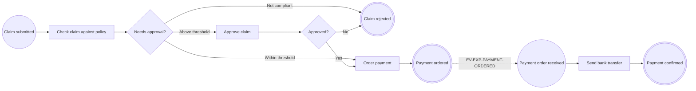

# Curso de bpmncode

> 🇬🇧 [English version](../../en/course/README.md)

Aprende a usar `bpmncode` paso a paso, de un proyecto Spring Boot vacío a una aplicación lista para producción.

Este curso no sustituye al [manual de referencia](../primeros-pasos.md): es un recorrido guiado. Cada lección añade
una pieza a la misma aplicación y te remite al manual cuando quieras todos los detalles.

## A quién va dirigido

A desarrolladores Java y Spring Boot que nunca han modelado procesos *code-first*. No necesitas saber BPMN: cada
elemento se explica cuando aparece. Sí conviene que sepas crear una aplicación Spring Boot, escribir un
`@RestController` y lanzar pruebas con JUnit.

## Requisitos

| | Versión |
|---|---|
| Java | 21 o superior (la librería se compila para 21 y se prueba también en 25) |
| Spring Boot | 4.1 (el curso usa `spring-boot-starter-parent` 4.1.1, la versión con la que se construye la librería) |
| Maven | el que traiga tu proyecto; los ejemplos usan `./mvnw` |
| bpmncode | 0.1.0 |
| Herramientas | `curl` (o cualquier cliente HTTP) y un navegador para abrir los diagramas |

La lección 8 añade una base de datos H2. No hace falta instalar nada más.

> Si compilas la librería tú mismo (`./mvnw install` en este repositorio), su versión es `0.1.0-SNAPSHOT`: usa ese
> número en tu `pom.xml`.

## El ejemplo: una solicitud de gastos

Todo el curso construye **una sola aplicación**, `expenses`: la tramitación de una solicitud de gastos.

1. Un empleado envía la solicitud.
2. Se comprueba que cumple la política de gastos (tiene justificantes y un importe válido).
3. Si el importe supera un umbral, un responsable la aprueba o la rechaza. Esa tarea espera días si hace falta.
4. Se ordena el pago. Tesorería hace la transferencia y, cuando el banco la confirma, se publica la confirmación de
   pago.
5. Más adelante cambia la política: aparece la versión 2 del proceso, con un umbral más bajo, mientras las solicitudes
   antiguas terminan con la versión 1.

Los nombres que vas a ver en todas las lecciones:

| Qué | Nombre |
|---|---|
| Paquete raíz | `com.example.expenses` |
| Proceso de la solicitud | `EXP-CLAIM`, clases `ExpenseClaimProcess` (v1) y `ExpenseClaimProcessV2` (v2) |
| Proceso de pago | `EXP-PAYMENT`, clase `ExpensePaymentProcess` |
| Nodos de `EXP-CLAIM` | `EXP-SUBMITTED`, `EXP-CHECK`, `EXP-ROUTE`, `EXP-APPROVE`, `EXP-DECISION`, `EXP-PAY`, `EXP-PAYMENT-ORDERED`, `EXP-REJECTED` |
| Nodos de `EXP-PAYMENT` | `PAY-ORDER-RECEIVED`, `PAY-TRANSFER`, `PAY-CONFIRMED` |
| Reglas de negocio | `R-EXP-001` (política de gastos), `R-EXP-002` (umbral de aprobación, versiones 1 y 2) |
| Mensajes | `EV-EXP-PAYMENT-ORDERED` (pago ordenado), `EV-EXP-PAYMENT-CONFIRMED` (pago confirmado) |

## Cómo seguirlo

- Haz las lecciones en orden. Cada una parte **exactamente** del código con el que terminó la anterior; el apartado
  «Punto de partida» te lo recuerda.
- Escribe el código tú mismo. Los fragmentos son completos: si una clase cambia mucho, se muestra entera.
- Al final de cada lección, haz lo que dice «Comprueba que funciona» antes de seguir. Si algo falla, mira «Errores
  frecuentes»: los mensajes que verás son los reales de la librería.
- Los ejercicios son opcionales. Su solución está plegada; no hace falta aplicarla para seguir con la siguiente
  lección, salvo que la lección lo diga.
- Los nombres de los procesos, nodos y reglas están en inglés porque son los **textos canónicos** del modelo (los que
  acaban en el BPMN); en la lección 10 los traducirás. Los comentarios del código están en español.

## Lecciones

| # | Lección | Qué aprendes |
|---|---|---|
| 1 | [Tu primer proceso y su diagrama](01-primer-proceso.md) | crear el proyecto, anotar un proceso mínimo y ver su BPMN |
| 2 | [Tareas, flujos y reglas de negocio](02-tareas-y-reglas.md) | los tres tipos de tarea, los flujos de secuencia y `@BusinessRule` |
| 3 | [Decisiones con gateways](03-decisiones-con-gateways.md) | ramificar el proceso con un `@ExclusiveGateway` que devuelve un `enum` |
| 4 | [Validación al compilar y al arrancar](04-validacion.md) | qué errores detecta `javac`, cuáles el arranque y cómo leerlos |
| 5 | [Ejecutar con el journal](05-ejecutar-con-el-journal.md) | registrar cada paso con `ProcessJournal`, resultados, correlación e historial |
| 6 | [Tareas que esperan](06-tareas-que-esperan.md) | retomar una instancia días después para completar una tarea humana |
| 7 | [Mensajes entre procesos](07-mensajes-entre-procesos.md) | iniciar un proceso con un mensaje, contratos congelados e idempotencia |
| 8 | [Persistencia: memoria, JDBC y JPA](08-persistencia.md) | guardar las instancias en una base de datos y en la misma transacción que tus datos |
| 9 | [Versiones de procesos y reglas](09-versiones.md) | publicar la versión 2 sin romper las instancias en curso |
| 10 | [BPMN, trazabilidad e i18n](10-bpmn-trazabilidad-i18n.md) | leer el XML exportado, recorrer la trazabilidad y traducir los textos |
| 11 | [Estadísticas y visor web](11-estadisticas-y-visor-web.md) | mapa de calor, camino de una instancia y el visor bpmn-js integrado |
| 12 | [Pruebas y producción](12-pruebas-y-produccion.md) | `ProcessAssertions`, configuración de producción y Spring Modulith |

Empieza por la [lección 1](01-primer-proceso.md).
